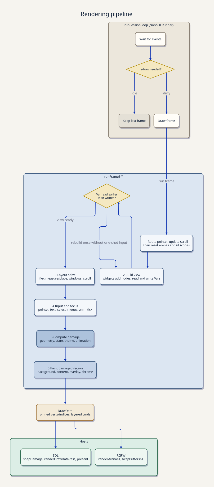

# Architecture & Internals

You do not need to memorize internals to build apps with `nano-ui`, but knowing how a frame executes explains why `readVar` placement, focus ordering, and damage tracking behave the way they do.

## The frame lifecycle



Every frame runs through six steps:

1. **Run the view.** Your `NanoUI ()` action executes top to bottom, declaring layout nodes, reading input events, and reading or updating `Var`s.
2. **Optional second pass.** If the view wrote to a `Var` that it had already read earlier in the same pass, `nano-ui` runs the view one more time (with one-shot clicks and key presses cleared) so earlier widgets pick up the new value.
3. **Solve layout.** The layout solver computes exact rectangles for every node from sizing rules, flex weights, gaps, and padding.
4. **Resolve input and focus.** Pointer hit-testing, hover/press states, keyboard shortcuts, and Tab focus order are resolved against the newly solved geometry.
5. **Compute damage.** Geometry, widget state, theme, and draw commands are diffed against the previous frame to find the minimal rectangles that actually changed.
6. **Paint and present.** The backend rasterizes only the damaged region into vertex and index buffers and presents it to the window.

Because layout runs *after* your view executes, `respRect` always reflects the **previous** frame's rectangle. Likewise, focus requests resolve at the end of the frame and appear focused on the next frame.

## Practical consequences

- **Views can run twice in one frame.** Always guard side effects behind events (`whenM (button ...)`), and never allocate persistent state or handles inside the view.
- **`readVar` placement affects pass count.** Putting `readVar` below the widget that edits it resolves edits in a single pass; reading above it triggers a second pass. Either way, damage tracking only repaints the widgets whose visual output changed.
- **Geometry lags by one frame.** On the very first frame a widget appears, `respRect` is empty. Headless tests warm up a frame before clicking computed rectangles.
- **Widget IDs come from sibling order.** Conditional widgets, reordered lists, and conditional overlays shift subsequent IDs unless stabilized with `scope`, `withKey`, and unconditional overlay calls. See [Widget Identity & Keys](../state/identity.md).
- **Idle windows use zero CPU and GPU.** When no animation, timer, task, or input event is active, the loop blocks in the OS event queue. Never dirty the context every frame to force redraws.

## Application architecture patterns

Real `nano-ui` applications (`ned`, `stronghead`, and `winget-gui`) all follow the same entry rule (**allocate once in `IO`, then run**), while choosing different structures for durable state.

```haskell
{{#include ../../../packages/nano-ui-demo/book/Book/Architecture.hs:main}}
```

### Pattern A: single domain `IORef` plus a wake channel

`winget-gui` stores package-manager state in one `IORef` and snapshots it at the top of each frame:

```haskell
{{#include ../../../packages/nano-ui-demo/book/Book/Architecture.hs:pattern_a}}
```

Snapshot everything into a plain `Frame` record before drawing, cache expensive derived lists in `IORef (Maybe (rev, value))` keyed by a revision counter, and handle keyboard shortcuts at the bottom of the view. This pattern works especially well when domain state is shared across worker threads, subprocesses, or network clients.

### Pattern B: an app record of `Var`s

`stronghead` organizes many independent panels by storing their view state in a top-level record of `Var`s:

```haskell
{{#include ../../../packages/nano-ui-demo/book/Book/Architecture.hs:pattern_b}}
```

Each panel module receives only the slice of `Var`s it owns. Choose this when your application is mostly interactive UI state with lightweight external I/O.

### Pattern C: application-owned state

`ned` keeps its entire editor state inside an `IORef App` that `nano-ui` knows nothing about. The view reads slices as needed and checks after input whether the view needs another frame:

```haskell
{{#include ../../../packages/nano-ui-demo/book/Book/Architecture.hs:pattern_c}}
```

Calling `requestFrame` schedules one immediate follow-up frame whenever an action invalidated what was just drawn. This fits text editors, terminals, emulators, and apps wrapping an existing headless library.

### Choosing a pattern

| If your application... | Good fit |
| --- | --- |
| Has one central domain state updated by workers or CLI commands | Pattern A (`IORef` + `askWake`) |
| Consists of many interactive tool panes and inspectors | Pattern B (record of `Var`s) |
| Wraps an existing domain model or library | Pattern C (app-owned `IORef` + `requestFrame`) |
| Fits pure `Msg -> Model -> Model` state transitions | Elm-style (`nano-ui-emit`) |
| Is a small utility or prototype | Keep it simple: a few `useVar` calls are plenty |

These patterns mix freely. Combining an `IORef` for domain data with `useVar` for view-local flags is standard, and an Elm-style reducer can happily run a single pane inside a larger `Var`-based app.

## View-writing discipline

Across every pattern, six habits keep views clean and fast:

1. Read state once at the top, or right before the section that needs it.
2. Build layout top to bottom (remembering that layout solves after the view returns).
3. Place `readVar` below the widgets that edit it when possible.
4. Run focus queries and focus-dependent keyboard shortcuts last.
5. Guard every side effect behind an event check.
6. Derive computed values fresh each frame, caching only genuinely expensive derivations by revision counter.
