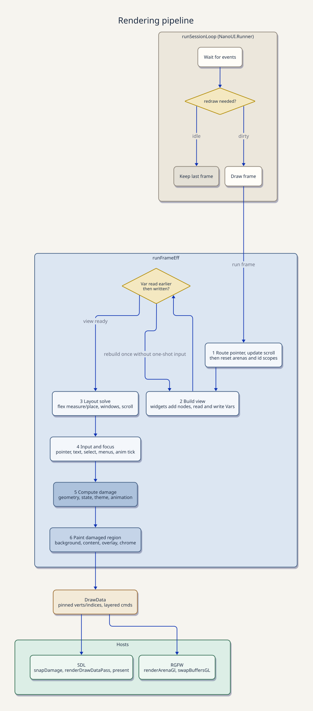

# Architecture & Internals

How a frame runs, and how applications are structured around it. None of this is needed to write a view; it explains what `readVar`, focus, and damage cost.

## The frame lifecycle



Each frame:

1. The `NanoUI ()` action runs top-to-bottom, appending layout nodes, reading input, and reading and writing `Var`s.
2. If a `Var` was written after it was read this pass, the action runs again with one-shot input events cleared.
3. The layout pass computes a rectangle for every node from flex weights, gaps, padding, and constraints.
4. Pointer coordinates, hover, press, shortcuts, and Tab order are resolved against the new geometry.
5. The new geometry and draw ops are diffed against the previous frame's to find the damaged region.
6. The backend rasterizes and presents only the damaged region.

The view runs before layout, so `respRect` is the **previous** frame's rectangle. Focus is resolved after the view, so a focus request takes effect next frame.

## Consequences

- The view can run more than once per frame. A write to a `Var` read earlier in the pass triggers a second pass with one-shot events cleared. Guard side effects with an event (`whenM (button ...)`), and never allocate frame-lived resources inside the view.
- `readVar` placement is a performance decision. Reading below the input that edits a value keeps a change to one pass; reading above costs a second pass. A `Var` bound to a widget with no `readVar` repaints only that widget; a `readVar` promotes the change to a full-window repaint.
- Geometry lags one frame. `respRect` is empty on a widget's first appearance. Tests warm up before targeting rectangles.
- Widget ids are positional. Conditional widgets, reordered lists, and conditional overlays change the count and therefore later ids. `scope` and `withKey` keep the counts stable; see [Widget Identity & Keys](../state/identity.md).
- An idle window costs nothing. With no animation, timed wake, task, or input, the loop blocks on the OS event queue. Do not dirty the context every frame to force redraws.

## Application patterns

Three applications (`ned`, `stronghead`, `winget-gui`) share one rule, **set up once in `IO`, then run**, and differ in where durable state lives.

```haskell
{{#include ../../../packages/nano-ui-demo/book/Book/Architecture.hs:main}}
```

### Pattern A: one domain state and a wake channel

`winget-gui` keeps package-manager results in one `IORef` and snapshots it at frame start:

```haskell
{{#include ../../../packages/nano-ui-demo/book/Book/Architecture.hs:pattern_a}}
```

Gather every read into one `Frame` record before building the window, memoize derived collections in `IORef (Maybe (key, value))` caches keyed by a revision counter, and read shortcuts after the widgets. Use this when the domain state is shared with workers, a database, or a protocol.

### Pattern B: an app record of `Var`s

`stronghead` has many independent panels, each with its own view state:

```haskell
{{#include ../../../packages/nano-ui-demo/book/Book/Architecture.hs:pattern_b}}
```

Panel modules take the slice they own. Use this when the application is mostly interactive UI state with little external I/O.

### Pattern C: application-owned state

`ned` keeps a plain `IORef App` that nano-ui holds no reference to. The view projects slices and re-reads after anything that may change the model:

```haskell
{{#include ../../../packages/nano-ui-demo/book/Book/Architecture.hs:pattern_c}}
```

`requestFrame` schedules one more frame; call it when what was drawn no longer matches the state. Use this for editors, terminals, games, and models that already exist as a library.

### Choosing

| The application… | Pattern |
| --- | --- |
| Has one domain state, uses worker threads, runs commands | A: `IORef` + `askWake` |
| Is a large set of interactive panes and tools | B: record of `Var`s |
| Has a model that predates the UI or is shared with a library | C: app-owned `IORef` + `requestFrame` |
| Is a state machine with explicit transitions | Elm-style (`nano-ui-emit`) |
| Is a small tool | Whatever is simplest; a handful of `useVar`s is fine |

Patterns mix. An `IORef` domain state with `Var` view state is normal; an Elm reducer can sit inside one pane of a `Var`-based application.

## The shared view discipline

1. Read state once at the top, or immediately before the subtree that uses it.
2. Build top-to-bottom. Layout is solved after the view.
3. Read after the parts that may write.
4. Run keyboard and focus queries last.
5. Guard effects with events. The view can run more than once per frame.
6. Keep derived values derived. Cache expensive work by revision, not by copying fields.
