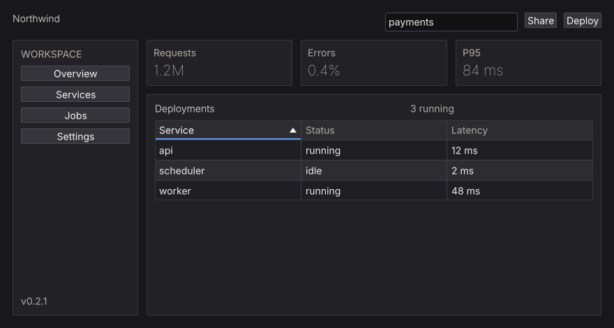

# Layout & Scrolling

Layout is a modifier argument to a container: `row` and `column` take a layout, and `rowWith`/`columnWith` take a `Layout -> Layout` function first. Modifiers compose with `(.)`, and **when two set the same property, the leftmost wins**.

```haskell
columnWith (gap 8 . padAll 12 . fillW) $ do
  label "Settings"
  buttonWith (fixedW 120) "Apply"
```

Logical pixels, origin top-left, `y` downward. Backends handle DPI scaling.

<figure class="nano-figure">

<figcaption>A frame built from a row, a sidebar panel, stat panels, and a table. Rendered with nano-ui-svg.</figcaption>
</figure>

## Containers

| Container | What it does |
| --- | --- |
| `row` / `rowWith` | Horizontal flow |
| `column` / `columnWith` | Vertical flow |
| `grid` / `gridWith` | Rows and columns with `gridCols n` |
| `panel` / `panelWith` | Styled surface with background, border, and padding |
| `card` | Full-width panel with a minimum width and spacing |
| `callout` | Informational/alert panel with a semantic tone |
| `layers` | Stacks children (later on top), aligning within the shared box |
| `center` | Centers content on both axes |
| `responsive` | Adapts layout to available width |
| `mouseArea` | Reports hover/clicks for a whole region |
| `separator` | Styled divider |
| `spacer` | Flexible space absorber |

A toolbar and a modal scrim:

```haskell
rowWith (gap 8 . padAll 8 . fillW . alignMid) $ do
  button "Back"
  button "Forward"
  spacer
  textInput searchVar

layers $ do
  mainContent
  panelWith (pinAt 0 0 . grow . pointer PointerBlock) modalDialog
```

## Modifiers

**Sizing**

- `fillW` / `fillH`: take all available space on an axis; `grow` is both.
- `fixedW w`, `fixedH h`, `fixedWH w h`: explicit logical pixels.
- `minW w`, `maxW w`, `minH h`, `maxH h`: bounds.
- `percent p`: a percentage of the parent.
- `aspect r`: width/height ratio.

**Spacing**

- `padAll p`, `padXY x y`, `padLeft`, `padRight`, `padTop`, `padBottom`, `padLRTB l r t b`.
- `gap g`: space between children.
- `tight`: remove internal padding but keep the gap.

**Alignment and wrapping**

- `alignMid`, `alignStart`, `alignEnd`, `alignCenter`, `alignTop`, `alignBottom`, `alignBaseline`.
- `wrap`: wrap onto new lines; add `lineGap` and `lineAlign`.

**Positioning and pointer behavior**

- `pinAt x y`: position absolutely within the parent. `pinAt 0 0 . grow` covers it for a scrim.
- `pointer PointerBlock`: consume pointer events (a scrim).
- `pointer PointerPass`: do not consume them (decorative drawing).

`alignMid` on a row positions the row itself in its parent. To centre the row's *contents*, apply it to each child or use `alignCenter` inside the row.

## Scrolling

A scroll container needs a bounded viewport on its scrolling axis:

```haskell
scrollWith (fixedH 300 . fillW) $
  column $ for_ items label
```

Without a bounded ancestor, `grow` can leave a scroller with nothing to size against.

- `scrollWith` returns the body's result.
- `scrollArea` also returns the scroller's `WidgetId`, for programmatic control.
- `scroll2DWith` / `scrollArea2D` scroll both axes.

### Virtualization

For 10,000+ rows, build only the visible slice and use spacers for the rest. Capture the scroller id and read the previous layout with `getScrollMetricsUi`:

```haskell
virtualizedList :: [Item] -> NanoUI ()
virtualizedList items = do
  sid <- currentId
  scrollWith (fixedH 500 . fillW) $ do
    metrics <- getScrollMetricsUi sid
    let rowH = 28
        total = length items
        (offsetY, viewH) = case metrics of
          Nothing -> (0, 0)
          Just m  -> (v2Y (scrollOffset m), rectH (scrollViewport m))
        firstVisible = max 0 (floor (offsetY / rowH))
        lastVisible  = min total (firstVisible + ceiling (viewH / rowH) + 2)
        topH    = fromIntegral firstVisible * rowH
        bottomH = fromIntegral (total - lastVisible) * rowH
        visibleRows = take (lastVisible - firstVisible) (drop firstVisible items)
    columnWith (tight . fillW) $ do
      when (topH > 0) (spacer Fit (Fixed topH))
      for_ visibleRows $ \item ->
        withKey (itemId item) $
          labelWith (fixedH rowH . fillW) (itemTitle item)
      when (bottomH > 0) (spacer Fit (Fixed bottomH))
```

`scrollViewport` excludes padding and the scrollbar lane; use it, not the container rectangle, for the visible height. `scrollOffset` is the current offset. The metrics read registers a layout dependency, so a resize triggers another frame.

See `packages/nano-ui-demo/examples/LongList.hs` (100,000 rows) and `Logs.hs` (sticky-to-bottom).

### Programmatic scrolling and wheel tuning

```haskell
metrics <- getScrollMetricsUi sid
when shouldReveal $
  scrollRectIntoViewUi sid (Rect 0 (row * rowH) 1 rowH) ScrollNearest ScrollInstant
```

From a view: `scrollToUi`, `scrollByUi`, `scrollPagesUi`, `scrollRectIntoViewUi`, `setScrollOffsetUi`, `setScrollStepUi`. The `Context` variants (`scrollTo`, `getScrollOffset2D`, ...) are for `IO`.

One wheel notch scrolls 60 logical pixels by default. For fixed-height rows, set the step so a notch is one row:

```haskell
ctx <- askContext
liftIO $ setScrollTuning ctx defaultScrollTuning
  {scrollWheelStep = rowHeight, scrollSmoothTime = 0}
```

`setScrollStepUi sid px` overrides one scroller; `0` restores the context step.

## Nesting and chrome

`scrollArea`, `panel`, and `card` each draw a background, border, and radius. Nesting them inside a popup or dialog draws a box in a box. Let one level own the chrome: flatten the inner surface with `styled (inputStyle (background colorTransparent . borderWidth 0))`, or give the outer dialog `padAll 0` and pad the inner body.

See [Styling Gotchas](../styling/gotchas.md) and [Troubleshooting](../troubleshooting/recurring-bugs.md) for the recurring cases.

## Related

- Widget inventory: [Widget Gallery](../widgets/index.md).
- Container styling: [Styling & Theming](../styling/index.md).
- Scrolling examples: `packages/nano-ui-demo/examples/LongList.hs`, `Logs.hs`.
