# Layout & Scrolling

Layout is a modifier argument to a container: `row` and `column` take a layout, and `rowWith`/`columnWith` take a `Layout -> Layout` function first. Modifiers compose with `(.)`, and **when two set the same property, the leftmost wins**.

```haskell
columnWith (gap 8 . padAll 12 . fillW) $ do
  label "Settings"
  buttonWith (fixedW 120) "Apply"
```

Logical pixels, origin top-left, `y` downward. Backends handle DPI scaling.

Each container and modifier in the next two sections has a collapsible example: open it for the code and the frame that code renders. The snippets show the arrangement itself; the rendered frames add `padAll 14` and fill the window so the spacing is visible.

## Containers

A container is a `NanoUI` action that arranges its children. The plain form (`row`) uses the inherited layout; the `...With` form takes a modifier function.

<details class="nano-example">
<summary><code>row</code> / <code>rowWith</code> — children left to right</summary>

```haskell
rowWith (gap 8) $
  mapM_ (void . button) ["One", "Two", "Three"]
```

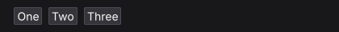

</details>

<details class="nano-example">
<summary><code>column</code> / <code>columnWith</code> — children top to bottom</summary>

```haskell
columnWith (gap 8) $
  mapM_ (void . buttonWith fillW) ["One", "Two", "Three"]
```

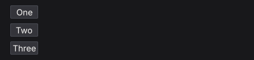

</details>

<details class="nano-example">
<summary><code>grid</code> / <code>gridWith</code> — rows of equal columns</summary>

```haskell
gridWith 3 (gap 8 . fillW) $
  mapM_
    (\i -> void (buttonWith fillW ("Cell " <> T.pack (show (i :: Int)))))
    [1 .. 6]
```

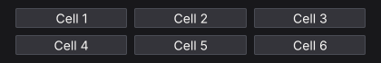

</details>

<details class="nano-example">
<summary><code>panel</code> / <code>panelWith</code> — a styled surface</summary>

```haskell
panelWith (fixedW 300 . padAll 12 . gap 6) $ do
  heading "Deployments"
  muted "3 services running"
```

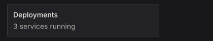

</details>

<details class="nano-example">
<summary><code>card</code> — a full-width panel with a minimum width</summary>

```haskell
card $ do
  heading "Build #482"
  muted "Passed in 1m 42s"
```

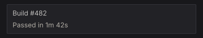

</details>

<details class="nano-example">
<summary><code>callout</code> — a panel tinted by a semantic colour</summary>

```haskell
warnCol <- themeWarning <$> uiTheme
callout warnCol $ do
  heading "Certificate expiring"
  muted "TLS certificate expires in 3 days."
```

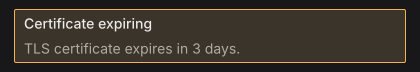

</details>

<details class="nano-example">
<summary><code>layers</code> — children stacked in one box, later on top</summary>

```haskell
layers $ do
  let badgeRed = colorRGB 204 64 64
  void (buttonWith (fixedWH 170 40) "Inbox")
  styled (panelStyle (background badgeRed . borderColor badgeRed)) $
    panelWith (alignEnd . alignTop . padXY 6 1) $
      labelWith (fontColor colorWhite) "3"
```

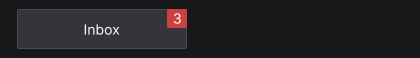

</details>

<details class="nano-example">
<summary><code>center</code> — content centred on both axes</summary>

```haskell
panelWith (fillW . fillH) $
  center (label "Centred on both axes")
```

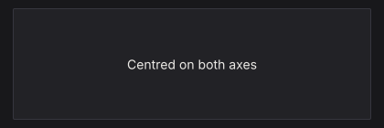

</details>

<details class="nano-example">
<summary><code>responsive</code> / <code>responsiveRowCol</code> — one layout when wide, another when narrow</summary>

`responsive breakpoint wide narrow body` picks a container by window width; `responsiveRowCol` is the common row/column pair.

```haskell
responsiveRowCol 640 (tight . gap 8 . fillW) $ do
  panelWith (fillW . padAll 12) (label "Sidebar")
  panelWith (fillW . padAll 12) (label "Content")
```

A 420 px window:

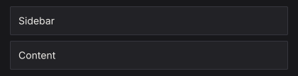

The same view at 760 px:

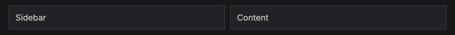

</details>

<details class="nano-example">
<summary><code>mouseArea</code> — hover and clicks for a whole region</summary>

```haskell
(_, area) <-
  panelWith fillW $
    mouseArea (fillW . padAll 10 . gap 4) $ do
      label "build.log"
      muted "Click anywhere in this card"
when (respClicked area) (muted "opening build.log")
```

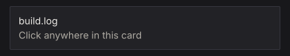

</details>

<details class="nano-example">
<summary><code>separator</code> — a one-pixel rule</summary>

```haskell
columnWith (fillW . gap 8) $ do
  label "Above the rule"
  separator
  label "Below the rule"
```

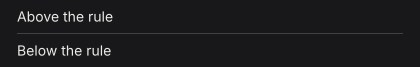

</details>

<details class="nano-example">
<summary><code>spacer</code> — flexible space between siblings</summary>

```haskell
rowWith (fillW . alignMid) $ do
  label "Left"
  spacer (Grow 1) Fit
  label "Right"
```

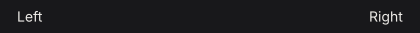

</details>

## Modifiers

Modifiers are `Layout -> Layout` functions. The leftmost wins when two set the same property, so `tight . padAll 14` has no padding while `padAll 14 . tight` keeps it.

### Sizing

<details class="nano-example">
<summary><code>fillW</code> — take all remaining width</summary>

```haskell
rowWith (fillW . gap 8) $ do
  void (buttonWith (fixedW 110) "fixedW 110")
  void (buttonWith fillW "fillW")
```

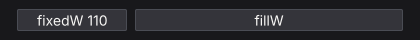

</details>

<details class="nano-example">
<summary><code>fillH</code> — take all remaining height</summary>

```haskell
rowWith (fillW . gap 8 . fixedH 96) $ do
  panelWith (fixedW 120 . fillH) (label "fillH")
  panelWith (fixedW 120) (label "natural")
```

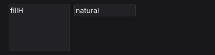

</details>

<details class="nano-example">
<summary><code>grow</code> — fill both axes (<code>fillW . fillH</code>)</summary>

```haskell
rowWith (grow . gap 8) $ do
  panelWith (fixedW 120) (label "fixedW 120")
  panelWith grow (label "grow")
```

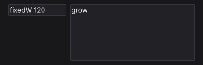

</details>

<details class="nano-example">
<summary><code>fixedW</code> — an exact width</summary>

```haskell
rowWith (gap 8) $ do
  void (buttonWith (fixedW 60) "60")
  void (buttonWith (fixedW 110) "110")
  void (buttonWith (fixedW 170) "170")
```

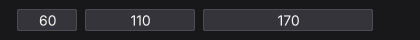

</details>

<details class="nano-example">
<summary><code>fixedH</code> — an exact height</summary>

```haskell
rowWith (gap 8 . fillW) $ do
  void (buttonWith (fixedH 30) "fixedH 30")
  void (buttonWith (fixedH 56) "fixedH 56")
  void (buttonWith (fixedH 82) "fixedH 82")
```

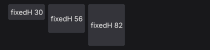

</details>

<details class="nano-example">
<summary><code>fixedWH</code> — an exact width and height</summary>

```haskell
rowWith (gap 8) $ do
  void (buttonWith (fixedWH 120 36) "120 x 36")
  void (buttonWith (fixedWH 200 72) "200 x 72")
```

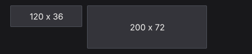

</details>

<details class="nano-example">
<summary><code>minW</code> — a lower width bound</summary>

```haskell
rowWith (fillW . gap 8) $ do
  void (buttonWith (minW 200) "minW 200")
  void (button "natural")
```

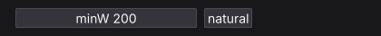

</details>

<details class="nano-example">
<summary><code>maxW</code> — an upper width bound</summary>

```haskell
rowWith (fillW . gap 8) $ do
  void (buttonWith (fillW . maxW 160) "maxW 160")
  void (buttonWith fillW "fillW")
```

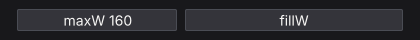

</details>

<details class="nano-example">
<summary><code>minH</code> — a lower height bound</summary>

```haskell
rowWith (fillW . gap 8) $ do
  panelWith (minH 80 . fillW) (label "minH 80")
  panelWith fillW (label "natural")
```

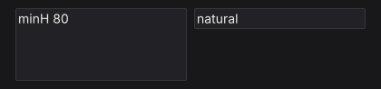

</details>

<details class="nano-example">
<summary><code>maxH</code> — an upper height bound</summary>

```haskell
rowWith (fillW . gap 8 . fixedH 100) $ do
  panelWith (maxH 50 . fillW) (label "maxH 50")
  panelWith (fillW . fillH) (label "fillH")
```

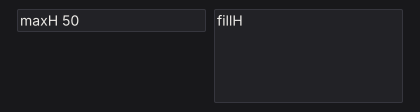

</details>

<details class="nano-example">
<summary><code>percent</code> — a percentage of the parent's width</summary>

```haskell
rowWith (fillW . gap 8) $ do
  panelWith (percent 30) (label "percent 30")
  panelWith (percent 60) (label "percent 60")
```

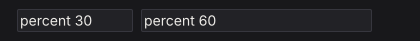

</details>

<details class="nano-example">
<summary><code>aspect</code> — keep a width / height ratio</summary>

```haskell
panelWith (fillW . aspect (16 / 9)) $
  center (label "16 : 9")
```

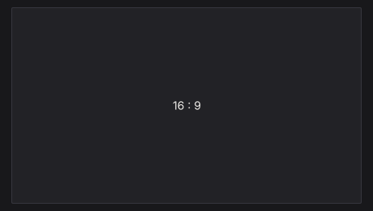

</details>

### Spacing

<details class="nano-example">
<summary><code>padAll</code> — equal padding on all four edges</summary>

```haskell
panelWith (fixedWH 260 120 . padAll 20) $
  panelWith (fillW . fillH) (label "padAll 20")
```

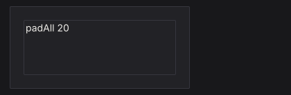

</details>

<details class="nano-example">
<summary><code>padXY</code> — horizontal, then vertical, padding</summary>

```haskell
panelWith (fixedWH 280 100 . padXY 32 10) $
  panelWith (fillW . fillH) (label "padXY 32 10")
```

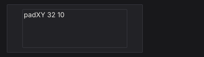

</details>

<details class="nano-example">
<summary><code>padLeft</code> — left padding</summary>

```haskell
panelWith (fixedWH 260 100 . padLeft 48) $
  panelWith (fillW . fillH) (label "padLeft 48")
```

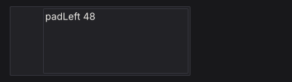

</details>

<details class="nano-example">
<summary><code>padRight</code> — right padding</summary>

```haskell
panelWith (fixedWH 260 100 . padRight 48) $
  panelWith (fillW . fillH) (label "padRight 48")
```

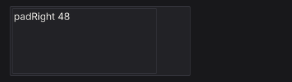

</details>

<details class="nano-example">
<summary><code>padTop</code> — top padding</summary>

```haskell
panelWith (fixedWH 260 120 . padTop 40) $
  panelWith (fillW . fillH) (label "padTop 40")
```

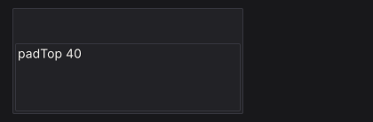

</details>

<details class="nano-example">
<summary><code>padBottom</code> — bottom padding</summary>

```haskell
panelWith (fixedWH 260 120 . padBottom 40) $
  panelWith (fillW . fillH) (label "padBottom 40")
```

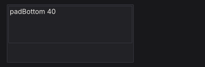

</details>

<details class="nano-example">
<summary><code>padLRTB</code> — left, right, top, bottom padding</summary>

```haskell
panelWith (fixedWH 280 120 . padLRTB 40 8 30 12) $
  panelWith (fillW . fillH) (label "padLRTB 40 8 30 12")
```

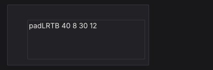

</details>

<details class="nano-example">
<summary><code>gap</code> — space between children</summary>

```haskell
columnWith (fillW . gap 12) $ do
  rowWith (gap 4) $ mapM_ (void . button) ["gap 4", "B", "C"]
  rowWith (gap 24) $ mapM_ (void . button) ["gap 24", "B", "C"]
```

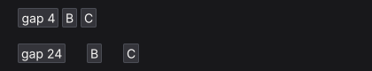

</details>

<details class="nano-example">
<summary><code>tight</code> — remove container padding, keep the gap</summary>

```haskell
rowWith (gap 16 . fillW) $ do
  panelWith (padAll 14 . gap 6 . fillW) $ do
    muted "padAll 14"
    label "default padding"
  panelWith (tight . padAll 14 . gap 6 . fillW) $ do
    muted "tight"
    label "no padding"
```

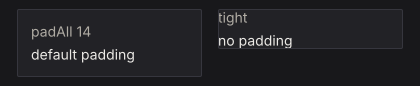

</details>

### Alignment and wrapping

`alignStart`, `alignCenter`, and `alignEnd` place a child across a column. `alignTop`, `alignMid`, and `alignBottom` place it down a row. A child always aligns itself; putting `alignMid` on a row positions the row in its parent, not the row's contents.

<details class="nano-example">
<summary><code>alignStart</code> — the left edge</summary>

```haskell
panelWith (fixedWH 300 110 . padAll 10) $
  void (buttonWith (alignStart . fixedW 140) "alignStart")
```

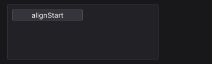

</details>

<details class="nano-example">
<summary><code>alignCenter</code> — the horizontal centre</summary>

```haskell
panelWith (fixedWH 300 110 . padAll 10) $
  void (buttonWith (alignCenter . fixedW 140) "alignCenter")
```

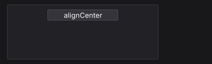

</details>

<details class="nano-example">
<summary><code>alignEnd</code> — the right edge</summary>

```haskell
panelWith (fixedWH 300 110 . padAll 10) $
  void (buttonWith (alignEnd . fixedW 140) "alignEnd")
```

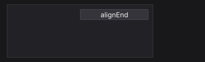

</details>

<details class="nano-example">
<summary><code>alignTop</code> — the top edge</summary>

```haskell
panelWith (fixedWH 300 110 . padAll 10) $
  rowWith (fillW . fillH . gap 8) $
    void (buttonWith (alignTop . fixedW 140) "alignTop")
```

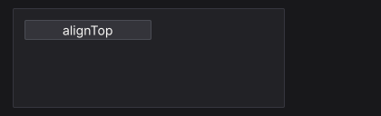

</details>

<details class="nano-example">
<summary><code>alignMid</code> — the vertical centre</summary>

```haskell
panelWith (fixedWH 300 110 . padAll 10) $
  rowWith (fillW . fillH . gap 8) $
    void (buttonWith (alignMid . fixedW 140) "alignMid")
```

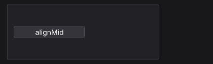

</details>

<details class="nano-example">
<summary><code>alignBottom</code> — the bottom edge</summary>

```haskell
panelWith (fixedWH 300 110 . padAll 10) $
  rowWith (fillW . fillH . gap 8) $
    void (buttonWith (alignBottom . fixedW 140) "alignBottom")
```

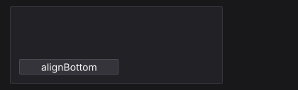

</details>

<details class="nano-example">
<summary><code>alignBaseline</code> — share the first baseline</summary>

```haskell
rowWith (gap 12 . fixedW 340) $ do
  labelWith (fontSize 24 . alignBaseline) "Title"
  labelWith alignBaseline "baseline text"
```

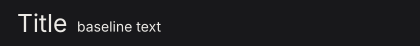

</details>

<details class="nano-example">
<summary><code>wrap</code> — start a new line when a child does not fit</summary>

```haskell
rowWith (wrap . gap 6 . fixedW 280) $
  mapM_ (void . button) ["haskell", "immediate", "mode", "layout", "sdl", "widgets"]
```

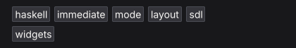

</details>

<details class="nano-example">
<summary><code>lineGap</code> — space between wrapped lines</summary>

```haskell
columnWith (fillW . gap 16) $ do
  let labels = ["haskell", "immediate", "mode", "layout", "sdl", "widgets"]
  muted "lineGap 2"
  rowWith (wrap . lineGap 2 . gap 6 . fixedW 280) $ mapM_ (void . button) labels
  muted "lineGap 18"
  rowWith (wrap . lineGap 18 . gap 6 . fixedW 280) $ mapM_ (void . button) labels
```

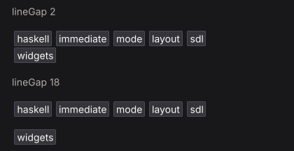

</details>

<details class="nano-example">
<summary><code>lineAlign</code> — align wrapped lines in the container</summary>

```haskell
rowWith (wrap . lineAlign LinesCenter . gap 6 . fixedW 210) $
  mapM_ (void . button) ["alpha", "beta", "gamma", "delta", "epsilon"]
```

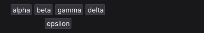

</details>

### Positioning and pointer behavior

`pinAt` takes a child out of the flow. `pointer` decides whether an overlapping region consumes pointer events (`PointerBlock`) or passes them to what is underneath (`PointerPass`). The pointer examples park the pointer over the overlay.

<details class="nano-example">
<summary><code>pinAt</code> — position absolutely inside the parent</summary>

```haskell
panelWith (fixedWH 280 110 . padAll 12) $ do
  heading "Inbox"
  muted "The badge is pinned, not stacked."
  let badgeCol = colorRGB 204 64 64
  styled (panelStyle (background badgeCol . borderColor badgeCol)) $
    panelWith (pinAt 6 (-6) . alignEnd . alignTop . padXY 6 1) $
      labelWith (fontColor colorWhite) "12"
```

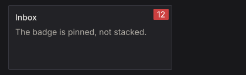

</details>

<details class="nano-example">
<summary><code>pointer PointerBlock</code> — consume pointer events over a region</summary>

```haskell
layers $ do
  void (buttonWith (fixedWH 200 44) "Open logs")
  styled (panelStyle (background (colorRGBA 0 0 0 150) . borderWidth 0)) $
    panelWith (pinAt 0 0 . grow . pointer PointerBlock . padAll 6) $
      muted "scrim"
```

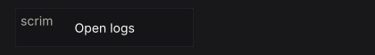

</details>

<details class="nano-example">
<summary><code>pointer PointerPass</code> — let pointer events through</summary>

```haskell
layers $ do
  void (buttonWith (fixedWH 200 44) "Open logs")
  labelWith (pinAt 8 (-6) . pointer PointerPass) "decorative label"
```

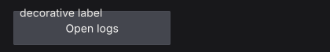

</details>

## Scrolling

A scroll container needs a bounded viewport on its scrolling axis:

```haskell
scrollWith (fixedH 300 . fillW) $
  column $ for_ items label
```

Without a bounded ancestor, `grow` can leave a scroller with nothing to size against.

- `scrollWith` returns the body's result.
- `scrollArea` also returns the scroller's `WidgetId`, for programmatic control.
- `scroll2DWith` / `scrollArea2D` scroll both axes.

### Virtualization

For 10,000+ rows, build only the visible slice and use spacers for the rest. Capture the scroller id and read the previous layout with `getScrollMetricsUi`:

```haskell
virtualizedList :: [Item] -> NanoUI ()
virtualizedList items = do
  sid <- currentId
  scrollWith (fixedH 500 . fillW) $ do
    metrics <- getScrollMetricsUi sid
    let rowH = 28
        total = length items
        (offsetY, viewH) = case metrics of
          Nothing -> (0, 0)
          Just m  -> (v2Y (scrollOffset m), rectH (scrollViewport m))
        firstVisible = max 0 (floor (offsetY / rowH))
        lastVisible  = min total (firstVisible + ceiling (viewH / rowH) + 2)
        topH    = fromIntegral firstVisible * rowH
        bottomH = fromIntegral (total - lastVisible) * rowH
        visibleRows = take (lastVisible - firstVisible) (drop firstVisible items)
    columnWith (tight . fillW) $ do
      when (topH > 0) (spacer Fit (Fixed topH))
      for_ visibleRows $ \item ->
        withKey (itemId item) $
          labelWith (fixedH rowH . fillW) (itemTitle item)
      when (bottomH > 0) (spacer Fit (Fixed bottomH))
```

`scrollViewport` excludes padding and the scrollbar lane; use it, not the container rectangle, for the visible height. `scrollOffset` is the current offset. The metrics read registers a layout dependency, so a resize triggers another frame.

See `packages/nano-ui-demo/examples/LongList.hs` (100,000 rows) and `Logs.hs` (sticky-to-bottom).

### Programmatic scrolling and wheel tuning

```haskell
metrics <- getScrollMetricsUi sid
when shouldReveal $
  scrollRectIntoViewUi sid (Rect 0 (row * rowH) 1 rowH) ScrollNearest ScrollInstant
```

From a view: `scrollToUi`, `scrollByUi`, `scrollPagesUi`, `scrollRectIntoViewUi`, `setScrollOffsetUi`, `setScrollStepUi`. The `Context` variants (`scrollTo`, `getScrollOffset2D`, ...) are for `IO`.

One wheel notch scrolls 60 logical pixels by default. For fixed-height rows, set the step so a notch is one row:

```haskell
ctx <- askContext
liftIO $ setScrollTuning ctx defaultScrollTuning
  {scrollWheelStep = rowHeight, scrollSmoothTime = 0}
```

`setScrollStepUi sid px` overrides one scroller; `0` restores the context step.

## Nesting and chrome

`scrollArea`, `panel`, and `card` each draw a background, border, and radius. Nesting them inside a popup or dialog draws a box in a box. Let one level own the chrome: flatten the inner surface with `styled (inputStyle (background colorTransparent . borderWidth 0))`, or give the outer dialog `padAll 0` and pad the inner body.

See [Styling Gotchas](../styling/gotchas.md) and [Troubleshooting](../troubleshooting/recurring-bugs.md) for the recurring cases.

## Related

- Widget inventory: [Widget Gallery](../widgets/index.md).
- Container styling: [Styling & Theming](../styling/index.md).
- Scrolling examples: `packages/nano-ui-demo/examples/LongList.hs`, `Logs.hs`.
