# Layout & Scrolling

Every layout container arranges the widgets declared inside its `do` block. Plain forms like `row` and `column` use the default layout, while `rowWith` and `columnWith` take a `Layout -> Layout` modifier function first. Modifiers compose with `(.)`, and **when two modifiers set the same property, the leftmost one wins**.

```haskell
{{#include ../../../packages/nano-ui-demo/book/Book/Layout.hs:modifiers}}
```

All coordinates and sizes use logical pixels with the origin at the top-left and `y` increasing downward. Backends handle DPI scaling automatically.

Expand any example below to inspect its Haskell source alongside the rendered output. Each frame adds `padAll 14` and fills the preview window so padding and alignment are easy to see.

## Containers

A container wraps a `NanoUI` action and positions its children. Use the plain form (`row`, `column`, `panel`) for defaults, or the `...With` variant to apply modifiers.

<details class="nano-example">
<summary><code>row</code> / <code>rowWith</code>: arrange children left to right</summary>

```haskell
{{#include ../../../packages/nano-ui-svg/app/LayoutExamples.hs:row}}
```

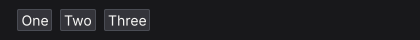

</details>

<details class="nano-example">
<summary><code>column</code> / <code>columnWith</code>: stack children top to bottom</summary>

```haskell
{{#include ../../../packages/nano-ui-svg/app/LayoutExamples.hs:column}}
```

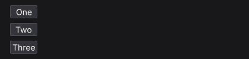

</details>

<details class="nano-example">
<summary><code>grid</code> / <code>gridWith</code>: place children in equal-width columns</summary>

```haskell
{{#include ../../../packages/nano-ui-svg/app/LayoutExamples.hs:grid}}
```

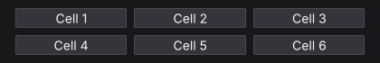

</details>

<details class="nano-example">
<summary><code>panel</code> / <code>panelWith</code>: a container with a background and border</summary>

```haskell
{{#include ../../../packages/nano-ui-svg/app/LayoutExamples.hs:panel}}
```

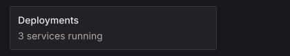

</details>

<details class="nano-example">
<summary><code>card</code>: a full-width panel with a minimum width</summary>

```haskell
{{#include ../../../packages/nano-ui-svg/app/LayoutExamples.hs:card}}
```

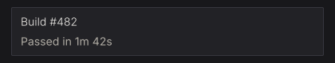

</details>

<details class="nano-example">
<summary><code>callout</code>: a panel tinted with a semantic color</summary>

```haskell
{{#include ../../../packages/nano-ui-svg/app/LayoutExamples.hs:callout}}
```

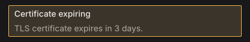

</details>

<details class="nano-example">
<summary><code>layers</code>: stack children in one box, later children on top</summary>

```haskell
{{#include ../../../packages/nano-ui-svg/app/LayoutExamples.hs:layers}}
```

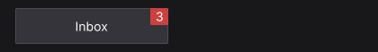

</details>

<details class="nano-example">
<summary><code>center</code>: center content on both axes</summary>

```haskell
{{#include ../../../packages/nano-ui-svg/app/LayoutExamples.hs:center}}
```

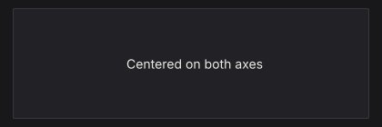

</details>

<details class="nano-example">
<summary><code>responsive</code> / <code>responsiveRowCol</code>: switch layouts at a breakpoint</summary>

`responsive breakpoint wide narrow body` chooses between two containers based on window width; `responsiveRowCol` switches between a row and a column.

```haskell
{{#include ../../../packages/nano-ui-svg/app/LayoutExamples.hs:responsive}}
```

At 420 px wide:

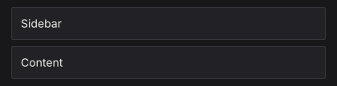

The same view at 760 px wide:

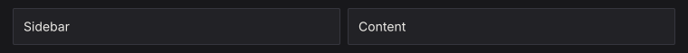

</details>

<details class="nano-example">
<summary><code>mouseArea</code>: track hover and clicks across a whole region</summary>

```haskell
{{#include ../../../packages/nano-ui-svg/app/LayoutExamples.hs:mousearea}}
```

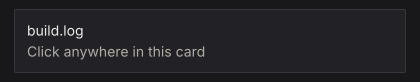

</details>

<details class="nano-example">
<summary><code>separator</code>: draw a one-pixel divider rule</summary>

```haskell
{{#include ../../../packages/nano-ui-svg/app/LayoutExamples.hs:separator}}
```

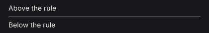

</details>

<details class="nano-example">
<summary><code>spacer</code>: insert flexible space between siblings</summary>

```haskell
{{#include ../../../packages/nano-ui-svg/app/LayoutExamples.hs:spacer}}
```

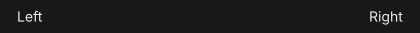

</details>

## Modifiers

Modifiers are plain `Layout -> Layout` functions chained with `(.)`. Because the leftmost function runs last in `(f . g) x`, it overrides anything to its right: `tight . padAll 14` zeroes padding out, while `padAll 14 . tight` keeps the 14 px padding.

### Sizing

<details class="nano-example">
<summary><code>fillW</code>: take all remaining horizontal space</summary>

```haskell
{{#include ../../../packages/nano-ui-svg/app/LayoutExamples.hs:fillw}}
```

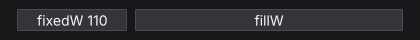

</details>

<details class="nano-example">
<summary><code>fillH</code>: take all remaining vertical space</summary>

```haskell
{{#include ../../../packages/nano-ui-svg/app/LayoutExamples.hs:fillh}}
```

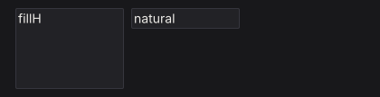

</details>

<details class="nano-example">
<summary><code>grow</code>: fill both axes (<code>fillW . fillH</code>)</summary>

```haskell
{{#include ../../../packages/nano-ui-svg/app/LayoutExamples.hs:grow}}
```

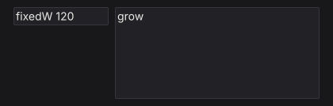

</details>

<details class="nano-example">
<summary><code>fixedW</code>: set an exact width</summary>

```haskell
{{#include ../../../packages/nano-ui-svg/app/LayoutExamples.hs:fixedw}}
```

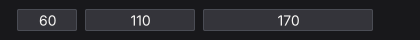

</details>

<details class="nano-example">
<summary><code>fixedH</code>: set an exact height</summary>

```haskell
{{#include ../../../packages/nano-ui-svg/app/LayoutExamples.hs:fixedh}}
```

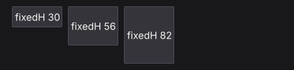

</details>

<details class="nano-example">
<summary><code>fixedWH</code>: set an exact width and height</summary>

```haskell
{{#include ../../../packages/nano-ui-svg/app/LayoutExamples.hs:fixedwh}}
```

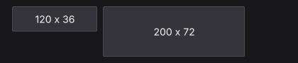

</details>

<details class="nano-example">
<summary><code>minW</code>: set a minimum width</summary>

```haskell
{{#include ../../../packages/nano-ui-svg/app/LayoutExamples.hs:minw}}
```

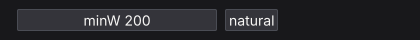

</details>

<details class="nano-example">
<summary><code>maxW</code>: cap width at an upper bound</summary>

```haskell
{{#include ../../../packages/nano-ui-svg/app/LayoutExamples.hs:maxw}}
```

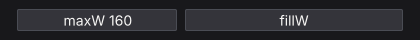

</details>

<details class="nano-example">
<summary><code>minH</code>: set a minimum height</summary>

```haskell
{{#include ../../../packages/nano-ui-svg/app/LayoutExamples.hs:minh}}
```

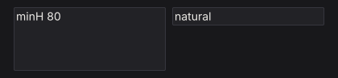

</details>

<details class="nano-example">
<summary><code>maxH</code>: cap height at an upper bound</summary>

```haskell
{{#include ../../../packages/nano-ui-svg/app/LayoutExamples.hs:maxh}}
```

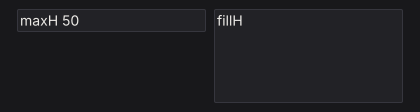

</details>

<details class="nano-example">
<summary><code>percent</code>: take a percentage of the parent's width</summary>

```haskell
{{#include ../../../packages/nano-ui-svg/app/LayoutExamples.hs:percent}}
```

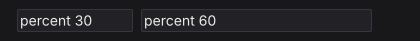

</details>

<details class="nano-example">
<summary><code>aspect</code>: preserve a width-to-height ratio</summary>

```haskell
{{#include ../../../packages/nano-ui-svg/app/LayoutExamples.hs:aspect}}
```

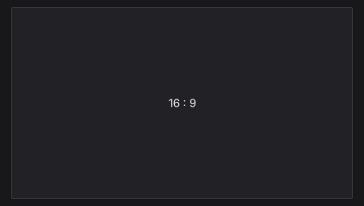

</details>

### Spacing

<details class="nano-example">
<summary><code>padAll</code>: equal padding on all four sides</summary>

```haskell
{{#include ../../../packages/nano-ui-svg/app/LayoutExamples.hs:padall}}
```

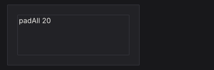

</details>

<details class="nano-example">
<summary><code>padXY</code>: horizontal padding first, then vertical</summary>

```haskell
{{#include ../../../packages/nano-ui-svg/app/LayoutExamples.hs:padxy}}
```

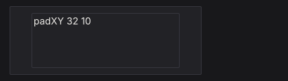

</details>

<details class="nano-example">
<summary><code>padLeft</code>: left padding</summary>

```haskell
{{#include ../../../packages/nano-ui-svg/app/LayoutExamples.hs:padleft}}
```

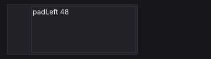

</details>

<details class="nano-example">
<summary><code>padRight</code>: right padding</summary>

```haskell
{{#include ../../../packages/nano-ui-svg/app/LayoutExamples.hs:padright}}
```

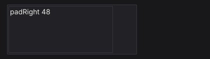

</details>

<details class="nano-example">
<summary><code>padTop</code>: top padding</summary>

```haskell
{{#include ../../../packages/nano-ui-svg/app/LayoutExamples.hs:padtop}}
```

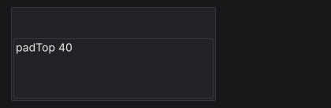

</details>

<details class="nano-example">
<summary><code>padBottom</code>: bottom padding</summary>

```haskell
{{#include ../../../packages/nano-ui-svg/app/LayoutExamples.hs:padbottom}}
```

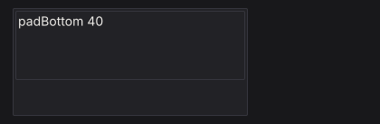

</details>

<details class="nano-example">
<summary><code>padLRTB</code>: individual left, right, top, and bottom padding</summary>

```haskell
{{#include ../../../packages/nano-ui-svg/app/LayoutExamples.hs:padlrtb}}
```

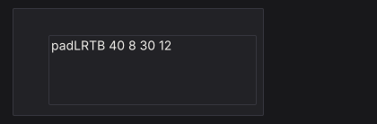

</details>

<details class="nano-example">
<summary><code>gap</code>: spacing between adjacent children</summary>

```haskell
{{#include ../../../packages/nano-ui-svg/app/LayoutExamples.hs:gap}}
```

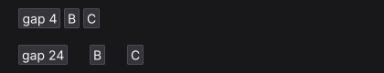

</details>

<details class="nano-example">
<summary><code>tight</code>: zero container padding while keeping its gap</summary>

```haskell
{{#include ../../../packages/nano-ui-svg/app/LayoutExamples.hs:tight}}
```

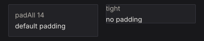

</details>

### Alignment and wrapping

`alignStart`, `alignCenter`, and `alignEnd` position a child horizontally inside a column. `alignTop`, `alignMid`, `alignBottom`, and `alignBaseline` position a child vertically inside a row.

Every `align*` modifier applies to the node it is placed on, not to that node's children. Putting `alignMid` on a `row` centers the row inside its parent. To align the children *inside* a container across its cross axis, put `itemsStart`, `itemsCenter`, `itemsEnd`, or `itemsBaseline` (or `itemsAlign`) on the container itself: `rowWith (itemsCenter . gap 8)` vertically centers every child that does not set its own vertical alignment, and `columnWith itemsCenter` centers fit-width children horizontally without affecting left-aligned text inside `fillW` labels. Any explicit `align*` modifier on a child (including `alignTop` or `alignStart`) overrides the container default, and `itemsAlign` never leaks into nested containers or pinned children.

<details class="nano-example">
<summary><code>alignStart</code>: align to the left edge</summary>

```haskell
{{#include ../../../packages/nano-ui-svg/app/LayoutExamples.hs:alignstart}}
```

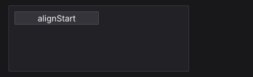

</details>

<details class="nano-example">
<summary><code>alignCenter</code>: center horizontally</summary>

```haskell
{{#include ../../../packages/nano-ui-svg/app/LayoutExamples.hs:aligncenter}}
```

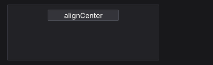

</details>

<details class="nano-example">
<summary><code>alignEnd</code>: align to the right edge</summary>

```haskell
{{#include ../../../packages/nano-ui-svg/app/LayoutExamples.hs:alignend}}
```

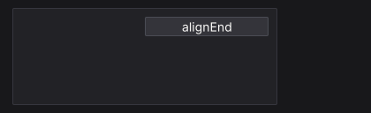

</details>

<details class="nano-example">
<summary><code>alignTop</code>: align to the top edge</summary>

```haskell
{{#include ../../../packages/nano-ui-svg/app/LayoutExamples.hs:aligntop}}
```

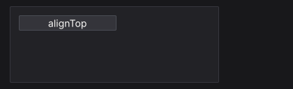

</details>

<details class="nano-example">
<summary><code>alignMid</code>: center vertically</summary>

```haskell
{{#include ../../../packages/nano-ui-svg/app/LayoutExamples.hs:alignmid}}
```

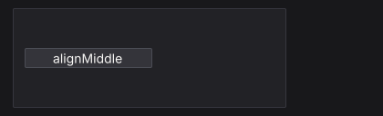

</details>

<details class="nano-example">
<summary><code>alignBottom</code>: align to the bottom edge</summary>

```haskell
{{#include ../../../packages/nano-ui-svg/app/LayoutExamples.hs:alignbottom}}
```

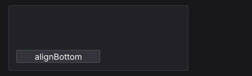

</details>

<details class="nano-example">
<summary><code>alignBaseline</code>: line up on the first text baseline</summary>

```haskell
{{#include ../../../packages/nano-ui-svg/app/LayoutExamples.hs:alignbaseline}}
```

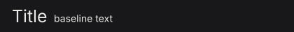

</details>

<details class="nano-example">
<summary><code>wrap</code>: wrap overflowing children onto the next line</summary>

```haskell
{{#include ../../../packages/nano-ui-svg/app/LayoutExamples.hs:wrap}}
```

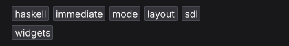

</details>

<details class="nano-example">
<summary><code>lineGap</code>: spacing between wrapped lines</summary>

```haskell
{{#include ../../../packages/nano-ui-svg/app/LayoutExamples.hs:linegap}}
```

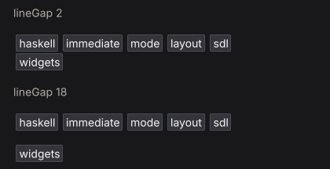

</details>

<details class="nano-example">
<summary><code>lineAlign</code>: align wrapped lines across the container</summary>

```haskell
{{#include ../../../packages/nano-ui-svg/app/LayoutExamples.hs:linealign}}
```

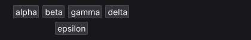

</details>

### Positioning and pointer behavior

`pinAt` pulls a child out of normal flow and positions it at an offset from its alignment corner inside its parent. `pointer` controls whether an overlapping element intercepts clicks (`PointerBlock`) or lets them pass through to widgets underneath (`PointerPass`). In the pointer examples below, the cursor is parked directly over the overlay.

<details class="nano-example">
<summary><code>pinAt</code>: position absolutely inside the parent</summary>

```haskell
{{#include ../../../packages/nano-ui-svg/app/LayoutExamples.hs:pinat}}
```

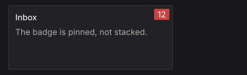

</details>

<details class="nano-example">
<summary><code>pointer PointerBlock</code>: absorb pointer events over a region</summary>

```haskell
{{#include ../../../packages/nano-ui-svg/app/LayoutExamples.hs:pointerblock}}
```

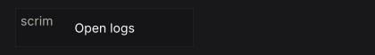

</details>

<details class="nano-example">
<summary><code>pointer PointerPass</code>: let pointer events pass through</summary>

```haskell
{{#include ../../../packages/nano-ui-svg/app/LayoutExamples.hs:pointerpass}}
```

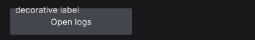

</details>

## Scrolling

A scroll container must have a bounded viewport along its scroll axis:

```haskell
{{#include ../../../packages/nano-ui-demo/book/Book/Layout.hs:scroll}}
```

If none of the scroller's ancestors constrain its size, `grow` leaves it with nothing to measure against.

- `scrollWith` scrolls vertically and returns its body's result.
- `scrollArea` also returns the scroller's `WidgetId` for programmatic scrolling.
- `scroll2DWith` and `scrollArea2D` scroll both horizontally and vertically.
- A full-viewport scroller (`scrollWith grow`) drops its bordered input well and fills with `pageBackground` (`themeWindow` by default). Wrap the view in `styled panelPage` if you want the page background to match the panel surface instead.

### Virtualization

For lists with tens of thousands of rows, build only the rows currently inside the viewport and pad above and below them with spacers. Grab the scroller's ID first and read its previous-frame layout with `getScrollMetricsUi`:

```haskell
{{#include ../../../packages/nano-ui-demo/book/Book/Layout.hs:virtualized}}
```

Use `scrollViewport` rather than the outer container rectangle for the visible height, since `scrollViewport` already subtracts padding and the scrollbar lane. `scrollOffset` gives the current scroll position. Calling `getScrollMetricsUi` registers a layout dependency, so resizing the window triggers a fresh frame automatically.

For complete examples, look at `packages/nano-ui-demo/examples/LongList.hs` (100,000 rows) and `Logs.hs` (auto-scrolling log tail).

### Programmatic scrolling and mouse-wheel step

```haskell
{{#include ../../../packages/nano-ui-demo/book/Book/Layout.hs:reveal}}
```

Inside a view, you can drive scrolling with `scrollToUi`, `scrollByUi`, `scrollPagesUi`, `scrollToStartUi`, `scrollToEndUi`, `scrollIntoViewUi`, `scrollRectIntoViewUi`, `setScrollOffsetUi`, and `setScrollStepUi`. Matching `Context` variants (`scrollTo`, `getScrollOffset2D`, and so on) are available in `IO`.

For custom keyboard-driven lists without a full `table` or `tree`, set `scrollFocusable = True` in `ScrollConfig` so the scroller joins the Tab order and takes focus when passive content inside it is clicked. Pair its `WidgetId` with `useListNav` (uniform row height) or `useListNavWith` (custom per-row rectangles) to handle Up, Down, PageUp, PageDown, Home, End, Enter, and Space with automatic `scrollRectIntoViewUi`.

By default, one mouse-wheel notch scrolls 60 logical pixels. For uniform lists, match the wheel step to your row height so one notch advances exactly one row (`askContext` lives in `NanoUI.Monad`):

```haskell
{{#include ../../../packages/nano-ui-demo/book/Book/Layout.hs:wheel_step}}
```

You can also override the wheel step for a single scroller with `setScrollStepUi sid px`; passing `0` restores the context default.

## Nesting and chrome

`scrollArea`, `panel`, and `card` each paint their own background, border, and corner radius. Nesting one inside a popup or modal produces an awkward box-within-a-box. Keep the frame at one level: either strip the inner surface with `styled (inputStyle (background colorTransparent . borderWidth 0))`, or set `padAll 0` on the outer dialog and put the padding on the inner body instead.

See [Styling Gotchas](../styling/gotchas.md) and [Troubleshooting](../troubleshooting/recurring-bugs.md) for more examples.
