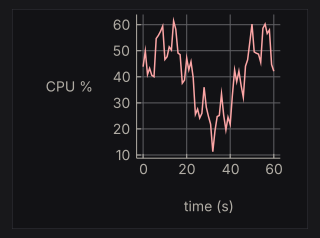
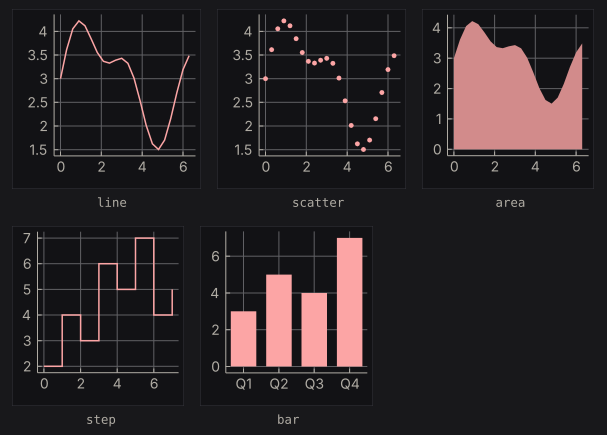
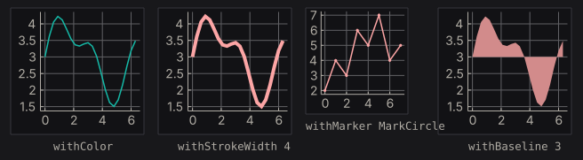
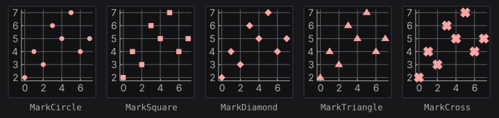
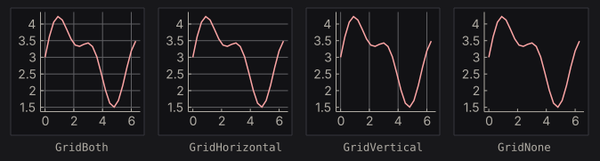
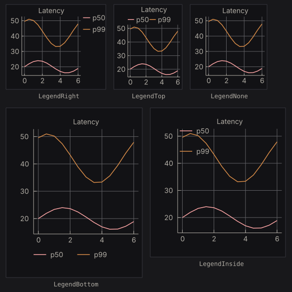
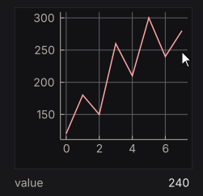
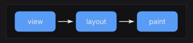

# Ecosystem Packages

Each package adds a backend or one capability to `nano-ui`. Pin them from source as in the [Quick Start](../getting-started/quickstart.md).

| Package | What it adds |
| --- | --- |
| `nano-ui-sdl` | SDL3 window backend, TrueType fonts, native file dialogs, custom chrome |
| `nano-ui-rgfw` | RGFW + OpenGL 3.2 backend with a bundled bitmap font |
| `nano-ui-diagrams` | Line/bar/scatter/area charts and diagrams-lib content |
| `nano-ui-form` | Validated applicative forms built on ditto |
| `nano-ui-markdown` | CommonMark rendering, appendable for streamed replies |
| `nano-ui-svg` | `DrawOp`-to-SVG and whole-frame SVG export |

## Backends

`nano-ui-sdl` is the primary desktop backend:

```haskell
import NanoUI.Backend.Sdl

main = runSdlApp
  defaultSdlOptions
    { sdlWindowSettings = defaultWindowSettings {wsTitle = "My App", wsSize = Size 1024 768}
    , sdlAppFont = FontSearch ["Segoe UI", "SF Pro Text", "Inter"]
    , sdlAppFontSize = 14
    , sdlAppTheme = Just defaultTheme
    }
  appView
```

It adds HarfBuzz shaping, installed-font lookup, high-DPI handling, non-blocking native file dialogs (`useFileDialog`), custom title bars (`windowCaption`), and screenshots (`saveScreenshot`, `captureScreenshot`). See [Desktop Windows](../advanced/window-management.md) for the window side.

`nano-ui-rgfw` is the zero-system-dependency alternative:

```haskell
import NanoUI.Backend.Rgfw

main = runRgfwApp defaultRgfwOptions appView
```

It links RGFW statically and bundles a bitmap font, so binaries are small and standalone. Use it where SDL3 is not available.

## Charts and diagrams

`nano-ui-diagrams` provides `NanoUI.Plot` and the diagrams-lib widget. `import NanoUI.Diagrams` brings in both. A chart is a plain `Chart` value; `plot` draws it, sized by a layout modifier:

```haskell
{{#include ../../../packages/nano-ui-svg/app/ChartExamples.hs:cpu_chart}}
```



Allocate the `PlotCache` once in `IO` with `newPlotCache` and keep it in the application record. It rebuilds a chart's drawing only when the chart or the theme changes, so building the `Chart` value every frame is cheap.

A chart keeps its drawing's proportions. With `fillW` the frame fills the width and the chart is centred in it; with only `fixedH` the widget takes the width the proportions give. A chart whose labels would overlap at the requested size is drawn larger, up to twice the size.

The examples below are compiled from [`ChartExamples.hs`](https://github.com/goolord/nano-ui/blob/main/packages/nano-ui-svg/app/ChartExamples.hs), which `nano-ui-svg-glossary` also renders to the images. They share this data:

```haskell
{{#include ../../../packages/nano-ui-svg/app/ChartExamples.hs:data}}
```

### Series

Series constructors take a name and the points: `(x, y)` pairs, or `(label, value)` pairs for `bar`. Each cell below plots `withLegend LegendNone (chart [s])`.



```haskell
{{#include ../../../packages/nano-ui-svg/app/ChartExamples.hs:series}}
```

Lines and steps join the points in the order given, so sort them first if they are not already in x order. An area fills down to zero. Bars sit in category order, each taking 72% of its slot. `lineChart`, `barChart`, `scatterChart`, and `areaChart` are one-series shortcuts that plot a list with a grid and no legend.

Series without a colour take the theme's series colours in order. The modifiers override the colour and size:



```haskell
{{#include ../../../packages/nano-ui-svg/app/ChartExamples.hs:styles}}
```

`withStrokeWidth` means the line width for a line or step, the marker size for a scatter, and the slot fraction for a bar. `withBaseline` sets where an area fills to, in data units, so values below it fill downward. A line's markers are twice its stroke width; a scatter's markers are its stroke width, 3 by default:



```haskell
{{#include ../../../packages/nano-ui-svg/app/ChartExamples.hs:markers}}
```

### Grid, titles, and legend

`withGrid` picks the grid lines drawn through the data box. Ticks and their labels stay either way.



```haskell
{{#include ../../../packages/nano-ui-svg/app/ChartExamples.hs:grids}}
```

`withTitle`, `withXAxis`, and `withYAxis` add titles. `withLegend` places the legend, which is on the right by default. At this height the bottom and inside legends would overlap other labels, so those two charts are drawn larger.



```haskell
{{#include ../../../packages/nano-ui-svg/app/ChartExamples.hs:legends}}
```

### Hover

`plot` returns a `PlotResponse`. Its `plotHover` is the point nearest the pointer, in data units, while the pointer is inside the data box:

```haskell
{{#include ../../../packages/nano-ui-svg/app/ChartExamples.hs:hover}}
```



The pointer rests by the seventh point, so the readout shows its 240. `hoverSeriesIdx` and `hoverPointIdx` say which series and point it is. Wrap the chart in `withCursorShape UiCursorCrosshair` to give the pointer a crosshair.

### Diagrams

`diagram` places any diagrams-lib `Diagram B` in the layout, framed like a chart and scaled to fit the layout modifier with its proportions kept. Colour it from the theme with `colourOf`, or take the chart colours from `uiPlotStyle`:

```haskell
{{#include ../../../packages/nano-ui-svg/app/ChartExamples.hs:diagram}}
```



Text in a diagram is measured with the current font so labels fit. The drawing is cached per theme and size, not per content: for a diagram that changes, use `diagramWithKeyAndEnvelope` with a key that changes with it. The live chart tutorial feeds a chart from a `Stream`: [Live Data & Background Work](../tutorials/live-data.md).

## Validated forms

`nano-ui-form` builds applicative forms on ditto. A `Form Text a` has `Text` errors and returns `a`:

```haskell
data Signup = Signup Text Text

signup :: Form Text Signup
signup =
  Signup
    <$> withFieldErrors (inputText "Name" "" `prove` notEmpty "Name is required")
    <*> withFieldErrors (inputText "Email" "" `prove` validEmail (const "Not an email address"))
```

Allocate `owner <- newFormState` once, then run it with a stable prefix:

```haskell
submitted <- nanoFormSubmit owner "signup" "Sign up" signup
case submitted of
  Just (Signup name _) -> label ("Welcome, " <> name)
  Nothing              -> pure ()
```

`nanoFormLive` returns `Just a` whenever the form is valid; `nanoFormEx` takes a `FormConfig`; `runNanoForm` returns the view and result separately. Inputs include `inputText`, `inputPassword`, `inputTextArea`, `inputCheckbox`, `inputSlider`, `inputSelect`, `inputRadio`, and `inputColor`. Validation includes `notEmpty`, `minLength`, `maxLength`, `inRange`, `validEmail`, `matches`, and `customProof`. `inputWidget` adapts any `Var a -> NanoUI Response` widget, with a publication policy (`OnChange`, `OnChangeOr`, `OnlyWhen`).

## Markdown

`nano-ui-markdown` parses with commonmark and draws with rich text:

```haskell
import NanoUI.Markdown

doc = parseMarkdown "# Hello\n\nSome *emphasis* and `code`."

view cache = do
  clicked <- markdown cache doc
  for_ clicked $ \url -> openUrl url
```

Allocate `cache <- newMarkdownCache` once. `markdown` returns the link clicked this frame. For streaming, append without reparsing the whole document:

```haskell
doc <- useStream stream replyId emptyMarkdown $ \update ->
  onToken client (\token -> update (appendMarkdown token))
void (markdown cache doc)
```

When appending on the UI thread, append a frame's tokens in one call. The parser reparses only the tail block, with a few documented exceptions (a long unsplittable final block, or a link-reference definition). `MarkdownConfig.mdBlock` overrides block drawing, for example to syntax-highlight code.

## SVG export

`nano-ui-svg` has two levels:

- **`NanoUI.Draw.Svg`** exports `DrawOp` sequences: `drawOpsToSvg bounds ops` or `renderDrawOpsSvg config`.
- **`NanoUI.Draw.FrameSvg`** re-renders a whole frame: `frameToSvg config ctx input drawData`.

```haskell
import NanoUI.Draw.FrameSvg (defaultFrameSvgConfig, enableSvgExport, frameToSvg)
import NanoUI.Testing (newPixelContext, runFrame)
import NanoUI.Testing.Harness (withInputOff)

exportViewToSvg view = do
  ctx <- newPixelContext
  let inp = withInputOff 1280 800
  enableSvgExport ctx
  (_, drawData, _) <- runFrame ctx inp view
  frameToSvg defaultFrameSvgConfig ctx inp drawData
```

`enableSvgExport` records the shapes paint draws and the text spans the exporter reads; `frameToSvg` fails on a context without it. Ids in the document take a prefix from its hash, so several SVGs can share a page. A `newPixelContext` measures text on a 16 px monospace grid; run the frames inside `withSdl` to measure in the real font. The specimens in this book are made this way.
