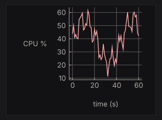
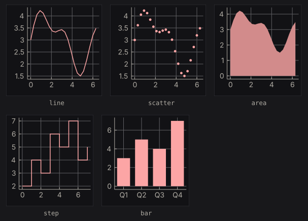
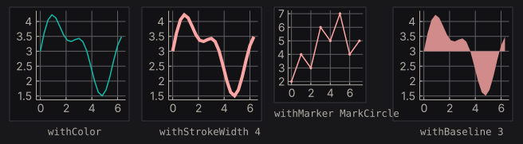
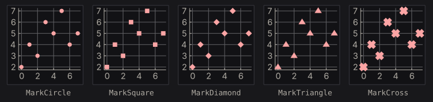
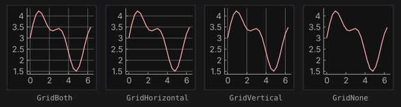
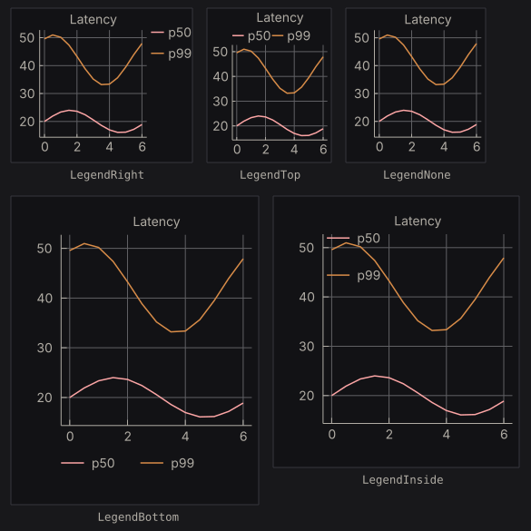
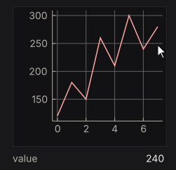
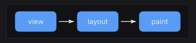

# Ecosystem Packages

The `nano-ui` workspace splits optional backends and domain widgets into focused companion packages. Pin whichever ones you need in `cabal.project` alongside `nano-ui`, as shown in the [Quick Start](../getting-started/quickstart.md).

| Package | What it adds |
| --- | --- |
| `nano-ui-sdl` | Desktop SDL3 backend with TrueType fonts, native file dialogs, and custom title bars |
| `nano-ui-rgfw` | Lightweight RGFW + OpenGL 3.2 backend with a bundled bitmap font |
| `nano-ui-sdl-web` | Browser backend for GHC's WebAssembly target using SDL_ttf and WebGL2 |
| `nano-ui-emit` | Statically typed emitting views and Elm-style reducers (`NanoUIE`) |
| `nano-ui-diagrams` | Line, bar, scatter, area, and step charts plus `diagrams-lib` widgets |
| `nano-ui-form` | Validated applicative forms built on `ditto` |
| `nano-ui-markdown` | CommonMark rendering with incremental appends for streaming |
| `nano-ui-shader` | Pure-Haskell typed fragment shader EDSL, multi-target GPU compiler, and 21 built-in effects |
| `nano-ui-svg` | `DrawOp`-to-SVG and full-frame SVG export |

## Backends

`nano-ui-sdl` is the main desktop backend:

```haskell
{{#include ../../../packages/nano-ui-demo/book/Book/Packages.hs:sdl}}
```

It provides HarfBuzz text shaping, system font discovery, high-DPI scaling, non-blocking native file dialogs (`useFileDialog`), custom title bars (`windowCaption`), and screenshot capture (`saveScreenshot`, `captureScreenshot`). See [Desktop Windows](../advanced/window-management.md) for window management details.

`nano-ui-rgfw` is a lightweight alternative with no SDL dependencies:

```haskell
{{#include ../../../packages/nano-ui-demo/book/Book/Packages.hs:rgfw}}
```

It compiles RGFW statically and ships with a bundled bitmap font, producing small standalone binaries whenever SDL3 is unavailable or unwanted.

## Charts and diagrams

`nano-ui-diagrams` provides both the `NanoUI.Plot` charting library and a widget for embedding `diagrams-lib` graphics (`import NanoUI.Diagrams` exports both). Build a plain `Chart` value and draw it with `plot`:

```haskell
{{#include ../../../packages/nano-ui-svg/app/ChartExamples.hs:cpu_chart}}
```



Create a `PlotCache` once in `IO` with `newPlotCache` and keep it in your app record. The cache only rebuilds vector geometry when the chart data or active theme changes, so constructing `Chart` values inside the view is cheap.

Charts preserve their aspect ratio automatically. With `fillW`, the outer frame expands to fill available width and centers the chart inside; with only `fixedH`, the chart takes the width implied by its proportions. If axis labels would collide at the requested size, the chart scales up (up to 2x) to keep labels legible.

The examples below come from [`ChartExamples.hs`](https://github.com/goolord/nano-ui/blob/main/packages/nano-ui-svg/app/ChartExamples.hs), rendered to SVG by `nano-ui-svg-glossary`. They share this sample dataset:

```haskell
{{#include ../../../packages/nano-ui-svg/app/ChartExamples.hs:data}}
```

### Series

Each series constructor takes a label and a list of `(x, y)` points (or `(category, value)` pairs for `bar`). Every cell below renders `withLegend LegendNone (chart [s])`:



```haskell
{{#include ../../../packages/nano-ui-svg/app/ChartExamples.hs:series}}
```

`line` and `step` connect points in list order, so sort by `x` beforehand if your input is unordered. `area` fills down to `y = 0` by default, and `bar` places categories in order, with each bar occupying 72% of its slot. For quick single-series plots with a grid and no legend, use `lineChart`, `barChart`, `scatterChart`, or `areaChart`.

Series automatically pull colors in order from the active theme's series palette unless you override them with modifiers:



```haskell
{{#include ../../../packages/nano-ui-svg/app/ChartExamples.hs:styles}}
```

`withStrokeWidth` sets line thickness for `line` and `step`, marker diameter for `scatter`, and slot width fraction for `bar`. `withBaseline` changes the horizontal baseline an area fills toward (in data coordinates), so points below the baseline fill downward. On a `line`, markers default to twice the stroke width; on a `scatter`, they match the stroke width (3 px by default):



```haskell
{{#include ../../../packages/nano-ui-svg/app/ChartExamples.hs:markers}}
```

### Grid, titles, and legends

`withGrid` chooses which grid lines appear behind the plot area while keeping ticks and tick labels visible:



```haskell
{{#include ../../../packages/nano-ui-svg/app/ChartExamples.hs:grids}}
```

Add titles with `withTitle`, `withXAxis`, and `withYAxis`, and position the legend with `withLegend` (it sits on the right by default). In the preview below, the bottom and inside-top-left variants expand automatically so their legends do not collide with tick labels:



```haskell
{{#include ../../../packages/nano-ui-svg/app/ChartExamples.hs:legends}}
```

### Hover inspection

`plot` returns a `PlotResponse` whose `plotHover` field reports the data point closest to the cursor (in data coordinates) whenever the pointer is over the plot box:

```haskell
{{#include ../../../packages/nano-ui-svg/app/ChartExamples.hs:hover}}
```



Here the pointer hovers near the seventh point, so the readout shows `240`. `hoverSeriesIdx` and `hoverPointIdx` identify the exact series and point index. Wrap the chart in `withCursorShape UiCursorCrosshair` to show a crosshair while hovering.

### Embedding `diagrams-lib` graphics

`diagram` renders any `diagrams-lib` `Diagram B` inside a layout container, scaling proportionally to fit your layout modifier. Pull colors from the active `Theme` using `colourOf`, or reuse chart palette colors from `uiPlotStyle`:

```haskell
{{#include ../../../packages/nano-ui-svg/app/ChartExamples.hs:diagram}}
```



Text inside a `Diagram` is measured with the active UI font so labels fit accurately. By default, `diagram` caches only by theme and size; if your diagram's content changes dynamically, use `diagramWithKeyAndEnvelope` with an explicit key. For an example feeding a chart from a live background stream, see [Tutorial 3: Live Data & Background Work](../tutorials/live-data.md).

## Validated forms

`nano-ui-form` builds type-safe applicative forms on top of `ditto`. A `Form Text a` collects `Text` validation errors and yields a parsed value of type `a`:

```haskell
{{#include ../../../packages/nano-ui-demo/book/Book/Packages.hs:form}}
```

Allocate `owner <- newFormState` once during setup, then render the form under a stable key:

```haskell
{{#include ../../../packages/nano-ui-demo/book/Book/Packages.hs:form_submit}}
```

`nanoFormLive` returns `Just a` continuously whenever the form is valid, `nanoFormEx` accepts a `FormConfig`, and `runNanoForm` separates the rendered view from its result. Built-in inputs cover `inputText`, `inputPassword`, `inputTextArea`, `inputCheckbox`, `inputSlider`, `inputSelect`, `inputEnumSelect`, `inputRadio`, `inputEnumRadio`, and `inputColor`, alongside `formLabel` and `formSeparator`, paired with validators such as `notEmpty`, `minLength`, `maxLength`, `inRange`, `validEmail`, `matches`, and `customProof`. Wrap any custom `Var a -> NanoUI Response` widget with `inputWidget`, choosing when edits publish (`OnChange`, `OnChangeOr`, or `OnlyWhen`).

## Markdown

`nano-ui-markdown` parses CommonMark (with GitHub tables, task lists, strikethrough, and autolinks) and renders it as selectable rich text:

```haskell
{{#include ../../../packages/nano-ui-demo/book/Book/Packages.hs:markdown}}
```

Allocate `cache <- newMarkdownCache` once during setup. `markdown` returns the URL of any link clicked on the current frame, and `markdownWith` applies a layout modifier to the document column. For streaming chat replies or live logs, append chunks incrementally without reparsing the whole document:

```haskell
{{#include ../../../packages/nano-ui-demo/book/Book/Packages.hs:markdown_stream}}
```

If tokens arrive on the UI thread, concatenate each frame's batch into a single `appendMarkdown` call. The incremental parser only reparses the trailing block (except when a chunk completes an unsplittable block or adds a link-reference definition). To customize rendering for specific elements (such as adding syntax highlighting to fenced code blocks), override `MarkdownConfig.mdBlock`.

## Shaders

`nano-ui-shader` provides a pure-Haskell typed fragment shader EDSL, algebraic pass fusion (`composeColor`, `composeDistort`, `distortThenColor`, `chainLayer`), compilers for GLSL 150, GLSL ES 300, SPIR-V, MSL, and a CPU reference evaluator, plus 21 built-in surface fills and subtree effects (`meshGradient4`, `gaussianBlur`, `dropShadow`, `groupOpacity`, and more). See the [Shaders](../advanced/shaders.md) chapter for full examples and backend fallback rules.

## SVG export

`nano-ui-svg` exports graphics at two levels:

- `NanoUI.Draw.Svg` exports raw `DrawOp` lists via `drawOpsToSvg bounds ops` or `renderDrawOpsSvg config`.
- `NanoUI.Draw.FrameSvg` exports an entire rendered UI frame via `frameToSvg config ctx input drawData`.

```haskell
{{#include ../../../packages/nano-ui-demo/book/Book/Packages.hs:frame_svg}}
```

Call `enableSvgExport` on your context beforehand so paint passes record vector shapes and text spans (`frameToSvg` fails without it). Generated clip and gradient IDs are prefixed from a hash of the SVG document, so multiple exported SVGs can live safely on the same HTML page. A headless `newPixelContext` measures text on a 16 px monospace grid; run your frames inside `withSdl` if you want real TrueType font metrics (which is how all the illustrations in this book are generated).
