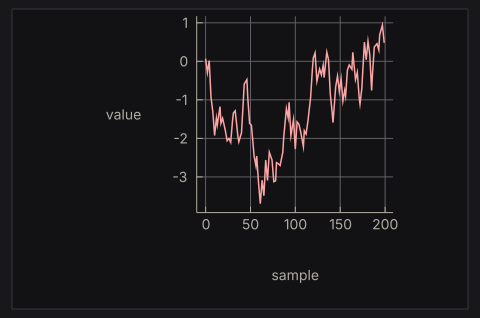

# Tutorial 3: Live Data & Background Work

A view must finish quickly so the interface stays responsive. Slow work like querying a database, fetching a URL, or reading from a sensor cannot block inside `NanoUI`. Instead, `nano-ui` runs background work on Haskell worker threads through two handles, `Task` and `Stream`, and wakes the event loop whenever new results arrive.

This tutorial walks through three panes from [`packages/nano-ui-demo/examples/Tasks.hs`](https://github.com/goolord/nano-ui/blob/main/packages/nano-ui-demo/examples/Tasks.hs) and the real-time chart in [`LiveChart.hs`](https://github.com/goolord/nano-ui/blob/main/packages/nano-ui-demo/examples/LiveChart.hs). Run them with:

```sh
cabal run nano-ui-example-tasks
cabal run nano-ui-example-live-chart
```

> [!IMPORTANT]
> Always compile executables with `-threaded`. While a background job runs, the main loop sleeps in the OS event wait; without the threaded runtime, that wait blocks worker threads too.

## 1. Allocate handles once

A `Task` runs a single keyed job to completion, while a `Stream` pushes a series of updates over time. Allocate both once in `IO` during startup, just like `newVar`:

```haskell
{{#include ../../../packages/nano-ui-demo/examples/Tasks.hs:handles}}
```

Each handle locks in its key and result types, keeping unrelated jobs separate.

## 2. Background search

We debounce user input with `searchInput'`, which only sets `respChanged` once typing pauses instead of firing on every keystroke. The committed query then becomes the task's key:

```haskell
{{#include ../../../packages/nano-ui-demo/examples/Tasks.hs:search_card}}
```

`slowSearch` is ordinary blocking `IO`:

```haskell
{{#include ../../../packages/nano-ui-demo/examples/Tasks.hs:slow_search}}
```

Here is how `useTaskStatus` coordinates the worker with the UI loop:

- On the first frame with a new key, it spawns a worker thread for that key.
- On subsequent frames while the worker runs, it returns immediately with `TaskRunning previous`. Keeping the previous result lets the UI show existing rows instead of flashing empty.
- When the worker completes, it wakes the loop so the next frame receives `TaskDone`.
- If the key changes before the worker finishes (for instance, the user commits a new search), the old thread is cancelled with an asynchronous exception and a fresh worker starts.

If you only need the latest available value and do not care about distinguishing loading or error states, `useTask` is shorter:

```haskell
{{#include ../../../packages/nano-ui-demo/book/Book/Async.hs:use_task}}
```

## 3. Retrying a failed job

If a task throws a synchronous exception, `useTaskStatus` returns `TaskFailed err previous`. To let a Retry button rerun the *same* input, include an attempt counter in the key:

```haskell
{{#include ../../../packages/nano-ui-demo/examples/Tasks.hs:flaky_card}}
```

Two rules stand out here:

- **Keys control restarts.** A task only restarts when its key changes. Including an integer attempt counter guarantees that clicking Retry always produces a fresh key.
- **Wrap status branches in `scope`.** Each `case` branch renders different widgets, so `scope` keeps widget IDs stable for everything that comes after the card.

Because cancellation delivers an asynchronous exception, always manage external resources inside a job with `bracket`:

```haskell
{{#include ../../../packages/nano-ui-demo/book/Book/Tutorials.hs:bracket}}
```

## 4. Streams: many updates, one frame

Use a `Stream` when a background producer pushes values repeatedly, such as progress updates, live telemetry, or streamed LLM tokens. The producer receives an `update` callback and runs until it returns or is cancelled:

```haskell
{{#include ../../../packages/nano-ui-demo/examples/Tasks.hs:progress_card}}
```

- **Stop a stream by stopping its call.** When `isRunning` becomes `False`, skipping `useStream` for a frame automatically cancels the producer thread.
- **Updates coalesce automatically.** If the producer calls `update` five times before the next frame renders, `nano-ui` runs one frame with the latest value.
- **Stopping resets stream state.** When the stream restarts, it starts back from its initial value (`0` here). If you want pause and resume instead of restart, save the latest value outside the stream and pass it back in as the initial value (as the live chart below does).
- **Keep persistent hooks outside tabs.** Just like `useTask`, a `useStream` call that is skipped for an entire frame cancels its worker.

When the progress stream is paused, the window stops redrawing and uses no CPU.

## 5. A live chart

To plot streaming data, pair a `Stream` with a `PlotCache`. Allocate the cache once in `IO` and pass it to `plot`:

```haskell
{{#include ../../../packages/nano-ui-demo/examples/LiveChart.hs:chart_handles}}
```

When paused, the view skips `useStream` and draws the last saved feed; resuming starts a new stream seeded with that saved state:

```haskell
{{#include ../../../packages/nano-ui-demo/examples/LiveChart.hs:chart_card}}
```

`Feed`, `advance`, and `fmt` live in `LiveChart.hs`, and `walkChart` constructs the `Chart` value:

```haskell
{{#include ../../../packages/nano-ui-demo/examples/LiveChart.hs:walk_chart}}
```

After 200 samples fill the rolling window, the chart looks like this:



The plotting API is compact:

- `line`, `scatter`, `bar`, `area`, and `step` construct series from `(x, y)` points (or `(label, value)` pairs for bars).
- `chart` combines a list of series, and `withGrid`, `withLegend`, `withXAxis`, `withYAxis`, and `withTitle` configure axes and labels.
- `plot cache layout theChart` renders the chart and returns a `PlotResponse` whose `plotHover` field gives the data point closest to the pointer.

Constructing a `Chart` value on every frame is cheap, and comparing a few hundred points takes almost no time. Rebuilding the underlying vector geometry is the expensive part, and `PlotCache` skips that rebuild whenever the chart and theme match the previous frame.

## 6. Things to try next

- Key a search task directly on the live query text (without debouncing) and observe how cancellation behaves compared to `searchInput'`.
- Stream Markdown tokens into `NanoUI.Markdown` with incremental appends (see [Ecosystem Packages](../packages/index.md)).
- Virtualize a 100,000-row log view using `getScrollMetricsUi` (see [Layout & Scrolling](../layout/index.md) and `Logs.hs`).
- Swap the streaming chart for a one-shot `Task` that loads a full dataset from disk.

For the full lifecycle details of tasks, streams, animations, and timers, see [Async Work & Animation](../advanced/async.md).
