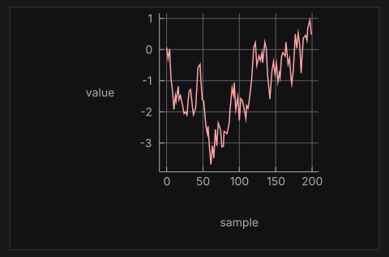

# Tutorial 3: Live Data & Background Work

A frame must finish quickly. Searching a database, downloading a file, or waiting for a sensor cannot happen inside the view, or the window stops responding while the work runs. nano-ui moves that work to worker threads behind two handles, `Task` and `Stream`, and wakes the frame loop when there is something new to draw.

This tutorial builds three small panes from [`packages/nano-ui-demo/examples/Tasks.hs`](https://github.com/goolord/nano-ui/blob/main/packages/nano-ui-demo/examples/Tasks.hs) plus the live chart from [`LiveChart.hs`](https://github.com/goolord/nano-ui/blob/main/packages/nano-ui-demo/examples/LiveChart.hs). Run them with:

```sh
cabal run nano-ui-example-tasks
cabal run nano-ui-example-live-chart
```

> [!IMPORTANT]
> Compile with `-threaded`. The frame loop sleeps while a job runs, and the job runs on a Haskell thread while the loop is blocked.

## 1. Allocate handles once

A `Task` runs one typed job; a `Stream` carries one typed push channel. Both are created during setup, like a `Var`:

```haskell
{{#include ../../../packages/nano-ui-demo/examples/Tasks.hs:handles}}
```

The handle fixes the key and result types, so a task cannot be reused for a different job.

## 2. A background search

The query field is debounced: `searchInput'` reports `respChanged` once typing pauses, not on every keystroke. The committed query becomes the task's key:

```haskell
{{#include ../../../packages/nano-ui-demo/examples/Tasks.hs:search_card}}
```

`slowSearch` is ordinary blocking IO:

```haskell
{{#include ../../../packages/nano-ui-demo/examples/Tasks.hs:slow_search}}
```

What the loop does with it:

- The first frame calls `useTaskStatus` with a new key, which starts a worker thread.
- Later frames return immediately. `TaskRunning previous` carries the last completed result, so the list does not flash empty when a new query starts.
- The worker finishes and wakes the loop for a frame. The next call reports `TaskDone`.
- Changing the key (typing a new committed query) cancels the old worker with an asynchronous exception and starts the new one.

`useTask` is the simpler variant when only the latest result matters:

```haskell
{{#include ../../../packages/nano-ui-demo/book/Book/Async.hs:use_task}}
```

## 3. Retrying a failed job

A job that throws becomes `TaskFailed err previous`. The exception is shown and the key includes an attempt counter, so pressing Retry reruns the *same* input:

```haskell
{{#include ../../../packages/nano-ui-demo/examples/Tasks.hs:flaky_card}}
```

Two rules are visible here:

- **The key must change to rerun.** Keying by the input alone would never restart an identical request; the attempt number is part of the key.
- **Each branch is a whole `scope`.** The branches declare different widgets; the scope keeps the widget ids after the card stable as the status changes.

Cancellation is an asynchronous exception, so acquire resources inside the job with `bracket`:

```haskell
{{#include ../../../packages/nano-ui-demo/book/Book/Tutorials.hs:bracket}}
```

## 4. Streams: many updates, one frame

A `Stream` is for work that pushes repeatedly: progress ticks, sensor readings, tokens from a model. The producer is a function that receives `update` and runs until it returns or is cancelled:

```haskell
{{#include ../../../packages/nano-ui-demo/examples/Tasks.hs:progress_card}}
```

- **Stopping is not calling the hook.** When `isRunning` is false, `useStream` is not called, and the producer is cancelled.
- **Updates coalesce.** If the producer pushes five values between two frames, the next frame draws the latest one; it does not run five frames.
- **The stream's state starts from the initial value.** Restarting after a pause begins at `0` here, which is why the label explains how to start over. To resume from the last state, save it outside and pass it as the initial value (the live chart below does exactly that).
- **Keep the hook outside tabs when the stream must keep running.** Like a task, a stream is released when its hook is skipped for a whole frame.

A paused progress pane costs no frames.

## 5. A live chart

The chart is a `Stream` feeding a `PlotCache`. The cache is allocated once and passed to `plot`; it compares the chart against the one it drew last time and rebuilds the diagram only when the data or theme changes:

```haskell
{{#include ../../../packages/nano-ui-demo/examples/LiveChart.hs:chart_handles}}
```

The view pauses by not calling the stream, and resumes from the saved feed:

```haskell
{{#include ../../../packages/nano-ui-demo/examples/LiveChart.hs:chart_card}}
```

`Feed`, `advance`, and `fmt` are in `LiveChart.hs`; `walkChart` builds the chart value:

```haskell
{{#include ../../../packages/nano-ui-demo/examples/LiveChart.hs:walk_chart}}
```

This is the chart after its first 200 samples, when the window is full:



The chart API is small:

- `line`, `scatter`, `bar`, `area`, and `step` build series from points (or category/value pairs for bars).
- `chart` takes the list of series; `withGrid`, `withLegend`, `withXAxis`, `withYAxis`, and `withTitle` decorate it.
- `plot cache layout theChart` draws it and returns a `PlotResponse` whose `plotHover` is the nearest data point under the pointer.

Building the `Chart` value every frame is fine: it is a plain value, and comparing a few hundred points is cheap. What is expensive is rebuilding the *diagram*; the `PlotCache` is what prevents that.

## 6. Try it

- Add a search that runs on every keystroke (key by the query) and compare the cancellation behaviour with `searchInput'`.
- Stream markdown tokens into `NanoUI.Markdown` and append them incrementally (see [Ecosystem Packages](../packages/index.md)).
- Virtualize a 100,000-row log list using `getScrollMetricsUi` (see [Layout & Scrolling](../layout/index.md) and the `Logs.hs` example).
- Replace the streamed chart with a `Task` that loads a whole dataset once.

The full lifecycle reference is [Async Work & Animation](../advanced/async.md).
