# Custom Drawing & Controls

When the built-in widgets do not cover what you need, you can draw directly with the 2D canvas API. The six controls in `NanoUI.Widgets.Custom` are built on this same API and double as clean templates for your own widgets.

## Built-in custom controls

`NanoUI` re-exports all six from `NanoUI.Widgets.Custom`:

| Control | Signature | Default size | Notes |
| --- | --- | --- | --- |
| `knob` | `Float -> Float -> Var Float -> NanoUI ()` | 36x36 | Min, max, value; drag vertically, scroll wheel, or use arrow keys |
| `toggleSwitch` | `Var Bool -> NanoUI ()` | 44x24 | Toggle with click, Space, or Enter |
| `circularProgress` | `Float -> NanoUI ()` | 32x32 | Progress fraction in `[0, 1]` |
| `progressBar` | `Float -> NanoUI ()` | full width, 12 high | Progress fraction in `[0, 1]` |
| `spinner` | `NanoUI ()` | 18x18 | Indeterminate spinner; wakes the loop at 60 Hz while visible |
| `sparkline` | `[Float] -> NanoUI ()` | 80x24 | Auto-scales vertically to the input range |

Every control provides a primed form (`knob'`, `toggleSwitch'`, and so on) returning a `Response`, plus a `...With` variant accepting a layout modifier and custom dimensions:

```haskell
{{#include ../../../packages/nano-ui-demo/book/Book/CustomDrawing.hs:with_forms}}
```

`sparkline` stretches the minimum value to the bottom of its plot box and the maximum to the top, so series of different scales remain readable in a tight strip. Here is a sparkline at its default size next to a wider `sparklineWith`:

```haskell
{{#include ../../../packages/nano-ui-svg/app/ChartExamples.hs:sparkline}}
```

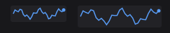

If you need axes, legends, or hover readouts, use `plot` from `nano-ui-diagrams` instead (see [Charts and diagrams](../packages/index.md#charts-and-diagrams)).

Here is a compact settings row combining a knob and a live readout:

```haskell
{{#include ../../../packages/nano-ui-demo/book/Book/CustomDrawing.hs:settings_row}}
```

Pinning the numeric label with `fixedW` prevents the row from jittering as digits change, and reading the `Var` *below* the knob keeps drags to a single pass.

`spinner` paces itself with `wakeAfter` (60 steps per second) only while it is visible on screen; once scrolled or clipped out of view, it stops requesting frames. Avoid calling a global `keepAnimating`, which would keep the event loop spinning even when no spinner is on screen.

### How custom controls are structured

Each control in `NanoUI.Widgets.Custom` follows the same four steps:

1. Claim an ID with `freshWidget`.
2. Size and render it via `CustomWidgetSpec` and `runCanvasFor`.
3. Handle user input with `useDrag2DOn`, `useWheelDeltaOn`, and `useKeyNav`.
4. Commit edits back to the caller's `Var` with `bindVar` or `finishInput`.

## Canvas drawing

`canvas` reserves a rectangle using a layout modifier and runs a `CanvasM` block inside it. The rectangle passed to your drawing callback is in window coordinates, so draw relative to its `Rect x y w h`:

```haskell
{{#include ../../../packages/nano-ui-svg/app/CanvasExamples.hs:import_path}}

{{#include ../../../packages/nano-ui-svg/app/CanvasExamples.hs:badge}}
```

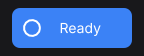

`canvas` returns a `Response`; wrap it in `void` if your drawing is purely decorative. `canvasConfigured` adds content-key caching, custom cursor shapes, and pointer tracking. When you need full control over sizing, keyboard handling, or focus, drop down to `customWidget` with a `CustomWidgetSpec`:

```haskell
{{#include ../../../packages/nano-ui-demo/book/Book/CustomDrawing.hs:custom_widget}}
```

Inside `widgetDraw`, `runCanvasFor` adjusts curve tessellation automatically for the display's DPI scale, and `drawContext` / `cdcTheme` give you the active `Theme`, font metrics, and hover/press state.

### Reading the canvas examples

The visual reference below comes straight from [`CanvasExamples.hs`](https://github.com/goolord/nano-ui/blob/main/packages/nano-ui-svg/app/CanvasExamples.hs), rendered directly to SVG by `nano-ui-svg-glossary`. Each list pairs a label with a drawing callback, sharing these colors and helper:

```haskell
{{#include ../../../packages/nano-ui-svg/app/CanvasExamples.hs:palette}}
```

Thin gray guides, dots, dashed outlines, and red crosshairs in the images below are reference annotations overlaid by the generator, not part of the snippets themselves.

### Rectangles, circles, and gradients

The basic drawing primitives take a rectangle or a center and radius, with no `NanoUI.Path` import required.

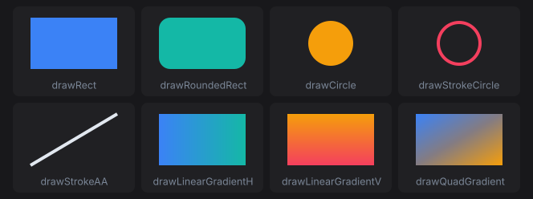

```haskell
{{#include ../../../packages/nano-ui-svg/app/CanvasExamples.hs:primitives}}
```

`drawStrokeCircle` insets its stroke inside the radius. `drawStrokeAA` draws an anti-aliased segment with square ends, while `drawStroke` skips anti-aliasing for crisp horizontal or vertical rules. `drawQuadGradient` takes its four corner colors clockwise starting from the top-left.

### Paths

A `Path` is a sequence of commands combined with `<>`. Start a subpath with `moveTo`, extend it with `lineTo`, `quadTo`, `cubicTo`, and `arc`, and connect back to the start with `close`. Below, each path is stroked with `drawStrokePath (path r) 3 blue`; solid dots mark path vertices, while hollow rings mark control points and arc centers.

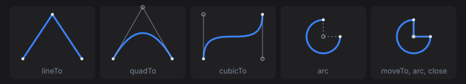

```haskell
{{#include ../../../packages/nano-ui-svg/app/CanvasExamples.hs:segments}}
```

Angles are in radians. Because `y` increases downward, positive angles sweep clockwise: `0` points to 3 o'clock, so a positive sweep of `3 * pi / 2` runs three-quarters of the way around clockwise. Calling `arc` after `moveTo` draws a straight line from the current point to the start of the arc, which makes pie wedges trivial.

Shape constructors build complete standalone subpaths. They never connect to prior subpaths, so joining them with `<>` builds a single multi-subpath shape:

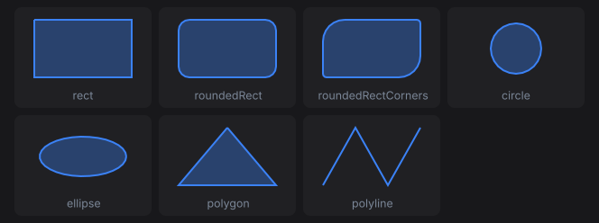

```haskell
{{#include ../../../packages/nano-ui-svg/app/CanvasExamples.hs:shapes}}
```

`roundedRectCorners` takes corner radii in CSS `border-radius` order: top-left, top-right, bottom-right, bottom-left. `polygon` closes the contour while `polyline` leaves it open (so the polyline is only stroked above). Filling a path implicitly closes every subpath.

### Fill rules

`drawPath` fills using `P.NonZero`, while `drawPathWith` lets you choose both the fill rule and paint. All three cells below fill three concentric circles:

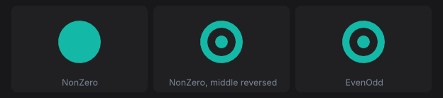

```haskell
{{#include ../../../packages/nano-ui-svg/app/CanvasExamples.hs:fill_rules}}
```

Because `P.circle` always winds clockwise, all three circles add together under `NonZero` to produce a solid disc. Reversing the middle circle cancels out its interior and punches a hole. `EvenOdd` ignores winding direction and simply alternates filled and empty as subpaths nest. Note that self-intersecting or crossing subpaths are not resolved against each other, so keep cutouts strictly inside their enclosing contour.

### Paints

`P.Solid` fills with a flat color. `P.Linear from to stops` interpolates color stops along the segment from `from` (offset `0`) to `to` (offset `1`):

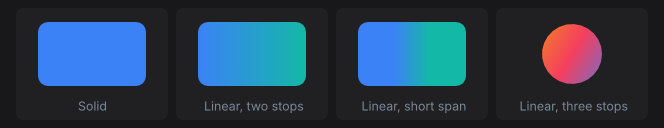

```haskell
{{#include ../../../packages/nano-ui-svg/app/CanvasExamples.hs:paints}}
```

Outside the first and last stops, the gradient clamps to the endpoint colors (visible in the middle-third example). Strokes accept `Paint` values too, so outlines can use gradients just like fills.

### Strokes

`drawStrokePathWith` accepts a `P.Stroke` record. Start with `P.stroke width` (butt caps, miter joins, solid line) and update the fields you need. Path strokes are always centered on the path geometry.

Line caps control how open path ends and individual dashes terminate. Compared against the thin path guide, `ButtCap` stops flush at the endpoints, while `RoundCap` and `SquareCap` extend past them by half the stroke width:

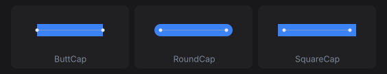

```haskell
{{#include ../../../packages/nano-ui-svg/app/CanvasExamples.hs:caps}}
```

Line joins control corners between consecutive segments. If a sharp miter point would stretch farther than `strokeMiterLimit * width`, it falls back to a flat bevel (demonstrated in the fourth cell with a miter limit of `1.5`):

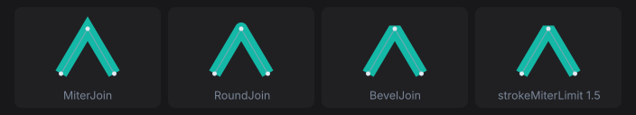

```haskell
{{#include ../../../packages/nano-ui-svg/app/CanvasExamples.hs:joins}}
```

`strokeDash` takes alternating dash and gap lengths that repeat along each subpath, and `strokeDashOffset` shifts where the pattern begins. Combining a zero-length dash with `RoundCap` produces round dots:

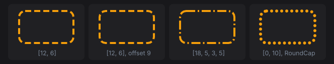

```haskell
{{#include ../../../packages/nano-ui-svg/app/CanvasExamples.hs:dashes}}
```

### Transforms

`withTransform` applies a `P.Transform` to everything drawn inside its block. Transforms compose with `<>` right-to-left (the right-hand transform runs first). The dashed outline below shows the arrow's untransformed position:

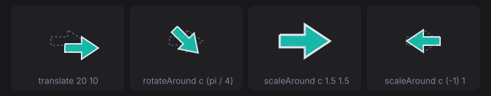

```haskell
{{#include ../../../packages/nano-ui-svg/app/CanvasExamples.hs:transforms}}
```

`P.rotate` and `P.scale` pivot around the window origin `(0, 0)`. To pivot around a shape's center instead, translate it to the origin first (`P.rotateAround` does this for rotation, and `scaleAround` above shows the equivalent for scaling). Stroke widths and dash patterns scale with the transform, which is why the scaled arrow has a thicker outline. Text positions and scales under transforms, though individual glyphs do not rotate.

### Clipping

`withClip rect` restricts drawing inside its block to the intersection of `rect` and the active clip region. Every canvas starts clipped to its own widget bounds, so drawings can never accidentally spill outside their widget.

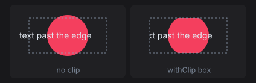

```haskell
{{#include ../../../packages/nano-ui-svg/app/CanvasExamples.hs:clip}}
```

### Text

`drawText pos alignX alignY txt color` places text relative to an anchor point (the red dot below). Alignment specifies which part of the text sits on that point: `AlignStart` anchors the left edge, `AlignTop` anchors the top of the line box, and `AlignBaseline` anchors the text baseline. Use `drawTextWith` with a `TextFont` to customize size, variant, weight, or slant.

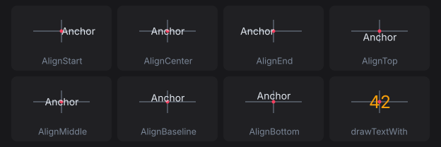

```haskell
{{#include ../../../packages/nano-ui-svg/app/CanvasExamples.hs:text}}
```

Measure strings inside the view using `lineWidthUi` and `uiFontMetrics` (or trim them to fit with `truncateTextUi`) and pass those measurements into your drawing callback. Both helpers ensure the needed glyphs are loaded first. The pure `lineWidth` is only exact for text that has already been measured or drawn; otherwise it falls back to summing per-glyph advances, which drifts from HarfBuzz's unrounded shaped runs over long strings.

### Borders: inset vs. centered

`drawStrokeRoundedRect` draws its entire border inside the given rectangle. By contrast, `drawStrokePath` centers the stroke on the path edge, pushing half the border width outside the rectangle. The thin guide below shows the exact rectangle passed to each call:

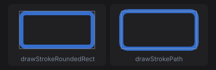

```haskell
{{#include ../../../packages/nano-ui-svg/app/CanvasExamples.hs:borders}}
```

Always use `drawStrokeRoundedRect` (or inset your path by half the stroke width) when stroking a widget's outer border so the edges do not get clipped by the widget bounds.

### Content keys and caching

Without a `widgetContent` key, `nano-ui` rebuilds and diffs a custom widget's draw ops on every frame. Adding a content key lets unchanged frames skip both rebuild and repaint, **as long as the key includes every input the drawing reads**:

```haskell
{{#include ../../../packages/nano-ui-demo/book/Book/CustomDrawing.hs:content_key}}
```

If you forget an input in the key, the canvas will freeze on stale pixels until something else forces a rebuild. See [Stale cached drawings](../troubleshooting/recurring-bugs.md#4-stale-cached-drawings).

A drawing whose layout bounds never change (such as a drag ghost moved via `pinAt` under the pointer) receives no layout diff when it moves. Give it an explicit version hash covering whatever drives its movement:

```haskell
{{#include ../../../packages/nano-ui-demo/book/Book/CustomDrawing.hs:versioned}}
```

Without a version key, it stays frozen on the draw ops from its very first frame.

## SVG icons

Parse inline SVG markup with `parseSvg` or load a file once at startup with `loadSvg`. Any stroke or fill using `currentColor` automatically inherits the active text color (so `fontColor` and semantic tones tint it cleanly), while hard-coded colors in the SVG stay untouched:

```haskell
{{#include ../../../packages/nano-ui-demo/book/Book/CustomDrawing.hs:svg_icons}}
```

`svgIconConfigured` takes an `ImageConfig` for CSS-style fitting (`FitContain`, `FitCover`, `FitFill`).

To paint an SVG inside a custom `canvas`, rasterize it with `rasterizeSvg` from `NanoUI.Svg`, upload it with `useImageRgba`, and draw the resulting `ImageId`. Make sure the lease key covers everything that changes the rasterized pixels (like the tint color):

```haskell
{{#include ../../../packages/nano-ui-demo/book/Book/CustomDrawing.hs:svg_canvas}}
```

For going in the other direction (exporting `nano-ui` draw ops or entire frames to SVG), see [SVG export](../packages/index.md#svg-export).
