# Custom Drawing & Controls

When the built-in widgets do not fit, draw the control with the canvas API. The six controls in `NanoUI.Widgets.Custom` are built on it, and their source is the example to copy.

## Reference custom controls

```haskell
import NanoUI.Widgets.Custom
```

| Control | Signature | Default size | Notes |
| --- | --- | --- | --- |
| `knob` | `Float -> Float -> Var Float -> NanoUI ()` | 36×36 | Min, max, value; vertical drag, wheel, arrows |
| `toggleSwitch` | `Var Bool -> NanoUI ()` | 44×24 | Click, Space, or Enter toggles |
| `circularProgress` | `Float -> NanoUI ()` | 32×32 | Fraction in `[0, 1]` |
| `progressBar` | `Float -> NanoUI ()` | fills width, 12 high | Fraction in `[0, 1]` |
| `spinner` | `NanoUI ()` | 18×18 | Indeterminate; requests animation frames while declared |
| `sparkline` | `[Float] -> NanoUI ()` | 80×24 | Scales to the values' range |

Each has a primed form returning `Response` (`knob'`, `toggleSwitch'`, ...) and a `...With` form that takes a layout modifier and size parameters:

```haskell
knobWith alignMid 48 0 100 volume
progressBarWith fillW 6 progress
sparklineWith (fixedWH 120 32) 120 32 samples
```

`sparkline` scales the values to their own range, so it shows the shape of a series, not its size. At its default size and with `sparklineWith`:

```haskell
{{#include ../../../packages/nano-ui-svg/app/ChartExamples.hs:sparkline}}
```

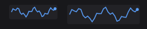

For a chart with axes, a legend, and hover, use `plot` from `nano-ui-diagrams` (see [Ecosystem Packages](../packages/index.md#charts-and-diagrams)).

A settings row:

```haskell
settingsRow :: Var Bool -> Var Float -> NanoUI ()
settingsRow enabled volume = rowWith (gap 12 . alignMid) $ do
  toggleSwitch enabled
  labelWith (alignMid . fixedW 64) "Enabled"
  knob 0 100 volume
  v <- readVar volume
  labelWith (alignMid . fontMono . fixedW 48) (T.pack (show (round v :: Int)))
```

The `fixedW` on the changing number keeps the controls from shifting. Read the value *below* the knob so a drag resolves in one pass.

`spinner` calls `keepAnimating` internally while it is drawn. Do not add a global `keepAnimating`; that would keep the loop running when the spinner is not visible.

### Implementing custom controls

Each control in `NanoUI.Widgets.Custom` follows the same steps:

1. Take an id with `freshWidget`.
2. Size and draw through a `CustomWidgetSpec` and `runCanvasFor`.
3. Turn input into a change of value with `useDrag2DOn`, `useWheelDeltaOn`, and `useKeyNav`.
4. Write the result to the caller's `Var` with `bindVar` or `finishInput`.

## Canvas drawing

`canvas` sizes a rectangle with a layout modifier and runs a `CanvasM` drawing in it. The rectangle is the widget's place in the window, so draw relative to it:

```haskell
import NanoUI.Path qualified as P

{{#include ../../../packages/nano-ui-svg/app/CanvasExamples.hs:badge}}
```

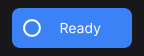

`canvas` returns the widget's `Response`; discard it with `void` when the drawing needs no hover or clicks. `canvasConfigured` adds a content key, a cursor, and pointer tracking. For full control, use `customWidget` with a `CustomWidgetSpec`:

```haskell
(resp, ()) <- customWidget defaultCustomWidgetSpec
  { widgetLayout = fixedWH 48 48
  , widgetContent = contentKey [angle, volume]
  , widgetDraw = \cdc (Rect x y w h) -> runCanvasFor cdc $ do
      drawCircle (V2 (x + w / 2) (y + h / 2)) 16 (themeAccent (cdcTheme cdc))
  , widgetCursor = Just (\_ _ _ -> UiCursorPointer)
  }
```

`runCanvasFor` adapts tessellation to the display scale inside `widgetDraw`. `drawContext` / `cdcTheme` supply the active theme, font, hover, and press state.

### Reading the examples

The rest of this section is compiled from [`CanvasExamples.hs`](https://github.com/goolord/nano-ui/blob/main/packages/nano-ui-svg/app/CanvasExamples.hs), and `nano-ui-svg-glossary` renders the same definitions to the images. Each list pairs a caption with a drawing, and the drawing gets one cell's rectangle. They share a palette and a helper:

```haskell
{{#include ../../../packages/nano-ui-svg/app/CanvasExamples.hs:palette}}
```

Thin grey lines, small dots, dashed outlines, and the red crosshair in the images are annotations drawn on top. They are not part of the example code.

### Rectangles, circles, and gradients

The basic ops take a rectangle or a centre and radius. They need no `NanoUI.Path` import.

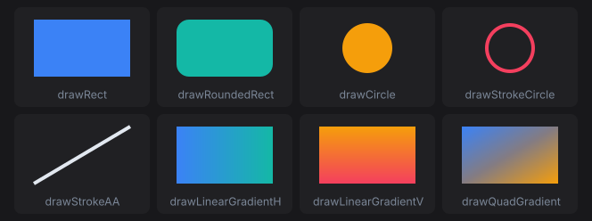

```haskell
{{#include ../../../packages/nano-ui-svg/app/CanvasExamples.hs:primitives}}
```

`drawStrokeCircle` keeps its border inside the radius. `drawStrokeAA` is an anti-aliased line with square ends; `drawStroke` is the same line without anti-aliasing, for axis-aligned rules. `drawQuadGradient` takes its colours clockwise from the top left.

### Paths

A `Path` is a list of steps joined with `<>`. `moveTo` starts a subpath. `lineTo`, `quadTo`, `cubicTo`, and `arc` extend it from the current point, and `close` draws a line back to where it started. Each path below is stroked with `drawStrokePath (path r) 3 blue`. Filled dots are points on the path; hollow dots are control points and arc centres.

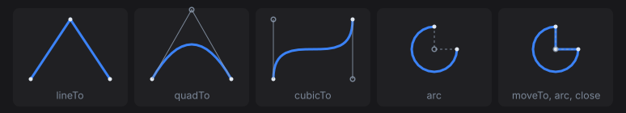

```haskell
{{#include ../../../packages/nano-ui-svg/app/CanvasExamples.hs:segments}}
```

Angles are in radians. Because y points down, a positive sweep turns clockwise on screen: the arc starts at 3 o'clock and runs three quarters of the way round. An `arc` after `moveTo` joins the current point to its start with a line, which is how the last cell draws a pie slice.

Shape helpers build whole subpaths. They never join onto what comes before them, so `<>` combines them into one path with several subpaths.

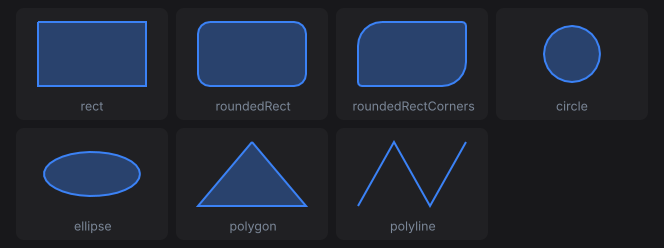

```haskell
{{#include ../../../packages/nano-ui-svg/app/CanvasExamples.hs:shapes}}
```

`roundedRectCorners` takes its radii in CSS `border-radius` order: top left, top right, bottom right, bottom left. `polygon` closes its outline and `polyline` leaves it open, so the polyline is only stroked here. A fill closes every subpath.

### Fill rules

`drawPath` fills with `P.NonZero`. `drawPathWith` takes the rule and a paint. All three cells fill three concentric circles:

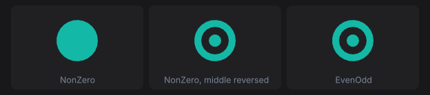

```haskell
{{#include ../../../packages/nano-ui-svg/app/CanvasExamples.hs:fill_rules}}
```

`P.circle` always runs clockwise, so under `NonZero` the inner circles add to the outer one and the disc is solid. Running the middle circle the other way cancels it out, cutting a hole. `EvenOdd` ignores direction: each nested subpath toggles between filled and empty. Crossing subpaths are not resolved against each other, so keep holes inside the shape they cut.

### Paints

`P.Solid` is one colour. `P.Linear from to stops` is a gradient along the line from `from` (offset 0) to `to` (offset 1).

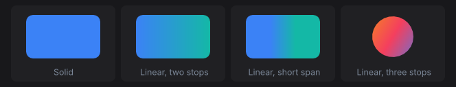

```haskell
{{#include ../../../packages/nano-ui-svg/app/CanvasExamples.hs:paints}}
```

Past the first and last stop the gradient keeps their colours, which the short span shows. Strokes take a `Paint` too, so a gradient can run along an outline.

### Strokes

`drawStrokePathWith` takes a `P.Stroke`. Start from `P.stroke width` (butt caps, miter joins, solid) and override fields with record update. Strokes are centred on the path.

Caps finish the ends of open subpaths and of every dash. The thin line is the path; butt caps stop at its end points, round and square caps extend past them by half the width.

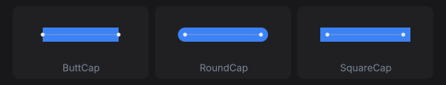

```haskell
{{#include ../../../packages/nano-ui-svg/app/CanvasExamples.hs:caps}}
```

Joins shape the corners between segments. A miter longer than `strokeMiterLimit` times the width falls back to a bevel, which the last cell forces with a limit of 1.5.

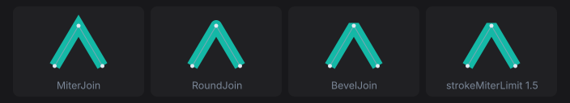

```haskell
{{#include ../../../packages/nano-ui-svg/app/CanvasExamples.hs:joins}}
```

`strokeDash` lists alternating dash and gap lengths, repeated along each subpath. `strokeDashOffset` starts the pattern part of the way in. A zero-length dash with round caps draws a dot.

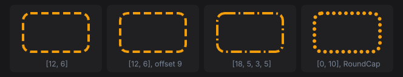

```haskell
{{#include ../../../packages/nano-ui-svg/app/CanvasExamples.hs:dashes}}
```

### Transforms

`withTransform` draws a block through a `P.Transform`. Transforms compose with `<>`, and the right-hand one applies first. The dashed outline is the arrow before the transform.

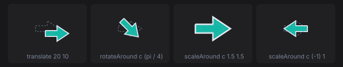

```haskell
{{#include ../../../packages/nano-ui-svg/app/CanvasExamples.hs:transforms}}
```

`P.rotate` and `P.scale` work about the window origin, not the widget. Move the pivot to the origin first: `P.rotateAround` does that for rotation, and `scaleAround` above does it for scale. Stroke widths and dashes scale with the transform, so the enlarged arrow's outline is thicker. Text moves its anchor and scales, but glyphs do not rotate.

### Clipping

`withClip rect` clips a block to `rect`, intersected with the current clip. The current clip is at most the widget's rectangle, so a canvas never draws outside its own bounds.

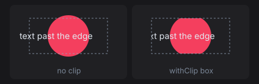

```haskell
{{#include ../../../packages/nano-ui-svg/app/CanvasExamples.hs:clip}}
```

### Text

`drawText pos alignX alignY txt colour` anchors text to a point. The alignment says which part of the text sits on the point (the red dot): `AlignStart` puts the point at the left edge, `AlignTop` at the top of the line, `AlignBaseline` on the baseline. `drawTextWith` takes a `TextFont` for size, variant, weight, and slant.

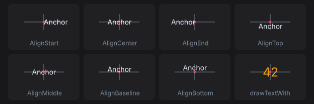

```haskell
{{#include ../../../packages/nano-ui-svg/app/CanvasExamples.hs:text}}
```

Measure text with `lineWidth` and `uiFontMetrics`. Measure a whole run with `lineWidth` rather than adding per-glyph advances, because a shaping backend lays runs out by unrounded advances.

### Borders: inset or centred

`drawStrokeRoundedRect` keeps its border inside the rectangle. A path stroke is centred on the path, so half its width falls outside. The thin outline is the rectangle both cells were given.

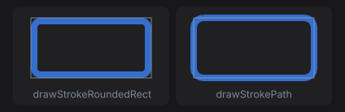

```haskell
{{#include ../../../packages/nano-ui-svg/app/CanvasExamples.hs:borders}}
```

Use the inset form for a widget's own border, so it never paints past the widget's rectangle.

### Content keys and caching

Without `widgetContent`, a custom widget's draw ops are rebuilt and diffed every frame. With a key, unchanged frames skip rebuild and repaint, but the key must cover **everything the drawing reads**:

```haskell
(resp, ()) <- customWidget defaultCustomWidgetSpec
  { widgetLayout = fixedWH 48 48
  , widgetContent = contentKey [angle, volume, fromIntegral (round scrollY)]
  , widgetDraw = \cdc rect -> runCanvasFor cdc (drawGauge rect)
  }
```

A key that misses an input shows stale pixels. See [Styling Gotchas](../styling/gotchas.md).

A drawing whose layout rectangle never changes (a drag ghost pinned under the pointer with `pinAt`) gets no layout change when it moves. Give it an explicit version that includes what moves it:

```haskell
-- dragGhostOps :: Rect -> SmallArray DrawOp
drawingVersioned (contentKey [mx, my]) (fixedWH 32 32) dragGhostOps
```

Otherwise it keeps the ops of the frame it first appeared in.

## SVG

`parseSvg` reads SVG text and `loadSvg` reads a file. An icon that strokes or fills with `currentColor` takes the text colour, so `fontColor` and the semantic styles tint it; other colours are kept.

```haskell
svgIcon 24 star
svgIconWith (fixedWH 32 32 . fontColor accent) star
whenM (iconButton star "Star") starItem
```

`svgIconConfigured` takes an `ImageConfig` for CSS-style fitting (`FitContain`, `FitCover`, `FitFill`).

Inside a canvas, rasterize the SVG with `rasterizeSvg` from `NanoUI.Svg`, lease the pixels with `useImageRgba`, and draw the image. Key the lease on everything the pixels depend on, here the tint:

```haskell
iid <- useImageRgba owner tint 32 32 (rasterizeSvg 32 32 tint star)
canvas (fixedWH 140 44) $ \(Rect x y _ _) ->
  for_ iid $ \i -> drawImage (Rect (x + 8) (y + 6) 32 32) i colorWhite
```

`nano-ui-svg` goes the other way and exports draw ops as SVG; see [SVG export](../packages/index.md#svg-export).
