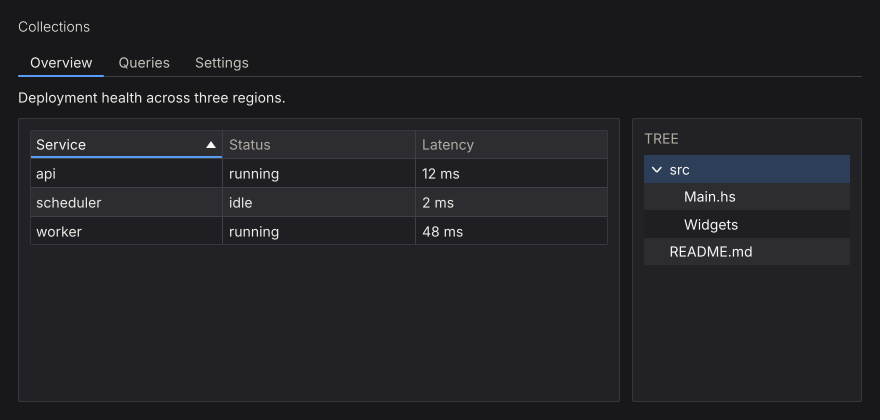
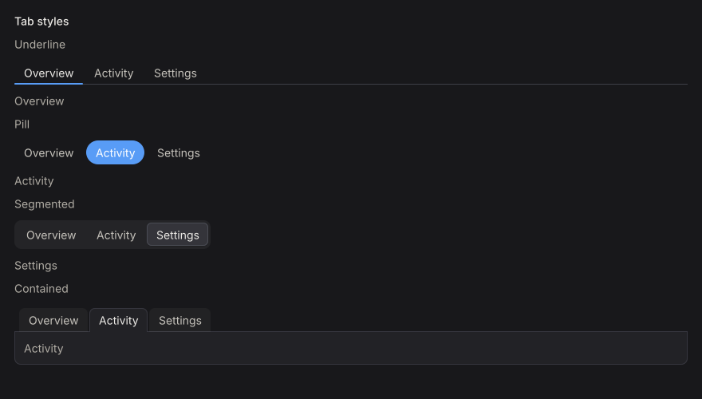

# Tabs, Tables & Trees

For structured navigation and multi-item data, `nano-ui` includes tabs, sortable virtualized tables, and collapsible tree views.

<figure class="nano-figure">

<figcaption>A tab strip, sortable table, and tree in one frame, rendered with nano-ui-svg.</figcaption>
</figure>

## Tabs

A tab container stores the active tab's key in a `Var` and runs only the selected tab's body:

```haskell
{{#include ../../../packages/nano-ui-demo/book/Book/DataViews.hs:bounded_tabs}}
```

Use `tab` for a standard tab, or `closableTab` to add a close button and middle-click dismissal. With `tabs'`, closing a tab reports the key in `tabClosed` without mutating your tab list, leaving you in charge of removing it and picking the next active tab:

```haskell
{{#include ../../../packages/nano-ui-demo/book/Book/DataViews.hs:closable_tabs}}
```

If the `Var` ever holds a key that does not match any current tab, `tabs` automatically selects the first tab and updates the `Var`.

If you want to render tab headers in one place and lay out the active body yourself, use `tabBar` or `tabBar'`. Both `tabsConfigured` and `tabBarConfigured` take a `TabsConfig`:

```haskell
{{#include ../../../packages/nano-ui-demo/book/Book/DataViews.hs:tabs_config}}
```

Here are all four built-in `TabStyle` options, each with a different tab active:

<figure class="nano-figure">

<figcaption>The four `TabStyle` variants, rendered with nano-ui-svg.</figcaption>
</figure>

| Style | Visual appearance |
| --- | --- |
| `TabUnderline` | Headers along a hairline rule, with an accent indicator under the active tab |
| `TabPill` | Rounded pill headers, with the active tab filled in the accent color |
| `TabSegmented` | Segmented control inside a rounded track, with the active segment raised |
| `TabContained` | Classic folder tabs whose active header opens directly into a bordered body |

Set `tabsOrientation` to `TabTop`, `TabBottom`, `TabLeft`, or `TabRight`. For enum-backed tabs, `enumTabs` / `enumTabsBy` and `enumTabBar` / `enumTabBarBy` generate one tab per constructor automatically.

## Tables

`table` renders structured columns built with `Colonnade`, with click-to-sort headers backed by a `Var SortCol`:

```haskell
{{#include ../../../packages/nano-ui-demo/book/Book/DataViews.hs:table}}
```

`SortCol` stores the active column index and sort direction. For quick text-only tables, `simpleTable headers rows` skips the Colonnade boilerplate. The primed `table'` returns a `TableResponse` with updated sort state, reordered columns, and hidden column indices; `tableConfigured` adds frozen rows/columns, fixed widths, `tableSqueeze`, `tableBare` (omit the outer border and well so an embedded table blends onto its pane), and column visibility options through `TableConfig`. Row rendering is virtualized internally. Users can drag column dividers down to a 40-pixel floor and double-click a divider to auto-fit the column to its content width (double-clicking again restores default fill sizing).

When building custom cells, use `textCell`, `cellWidget`, or attach typed sort keys with `cellSort` (text), `cellSortNum` (floating-point `SortNum`), `cellSortInt` (64-bit integer `SortInt`), or `cellSortKey` (`SortKey`) so numeric columns sort numerically instead of lexicographically. If a cell renders a custom widget, set `cellWidthText` (or `cellText`) so automatic column width measurement accounts for it.

## Trees

```haskell
{{#include ../../../packages/nano-ui-demo/book/Book/DataViews.hs:tree}}
```

`tree` renders a list of `TreeItem` values (`treeItemLabel` and `treeItemChildren`) and tracks selection in a `Var Int` as a **pre-order index**. Walk your tree in the same pre-order traversal whenever you map that index back to a domain object. Collapsed branches preserve their sub-branch expansion state, and rows behave like focusable buttons with arrow-key navigation.

For very large trees, store the set of expanded nodes in a `VarMap` keyed by a stable path and build only the visible slice before passing it to `tree`.

To let users reorder tabs by dragging, see [Drag & Drop](drag-and-drop.md).
