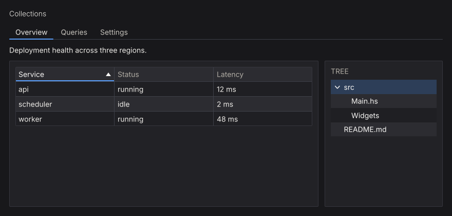
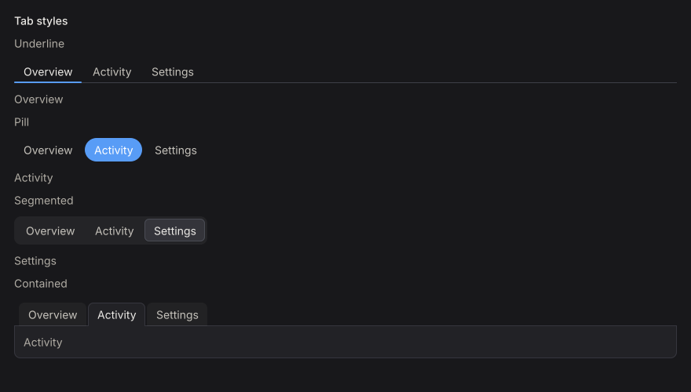

# Tabs, Tables & Trees

<figure class="nano-figure">

<figcaption>A tab strip, sortable table, and tree in one frame. Rendered with nano-ui-svg.</figcaption>
</figure>

## Tabs

A tab strip binds the active key to a `Var`; only the selected tab's body runs:

```haskell
{{#include ../../../packages/nano-ui-demo/book/Book/DataViews.hs:bounded_tabs}}
```

`tab` creates a plain header; `closableTab` adds a close button and reports the close through the primed response:

```haskell
{{#include ../../../packages/nano-ui-demo/book/Book/DataViews.hs:closable_tabs}}
```

`tabs'` reports `tabClosed` and leaves the tab in place; the caller removes it from its list. A key no tab has selects the first tab and writes that key back to the `Var`.

`tabBar` / `tabBar'` draw headers only and leave the body to the caller. `tabsConfigured` / `tabBarConfigured` take a `TabsConfig`:

```haskell
{{#include ../../../packages/nano-ui-demo/book/Book/DataViews.hs:tabs_config}}
```

The four `TabStyle`s, with a different tab selected in each:

<figure class="nano-figure">

<figcaption>The four `TabStyle` values, rendered with nano-ui-svg.</figcaption>
</figure>

| Style | Header treatment |
| --- | --- |
| `TabUnderline` | Headers on a rule; the selected header has an accent bar |
| `TabPill` | The selected header is filled with the accent color |
| `TabSegmented` | Headers sit in a rounded track; the selected one is raised |
| `TabContained` | Folder tabs; the selected header opens onto a bordered body |

Placements: `TabTop`, `TabBottom`, `TabLeft`, `TabRight`. `boundedTabs` / `boundedTabBar` generate a tab per enum value.

## Tables

`table` renders Colonnade columns. Header clicks sort through a `Var SortCol`:

```haskell
{{#include ../../../packages/nano-ui-demo/book/Book/DataViews.hs:table}}
```

`SortCol` holds the active column and direction. `simpleTable headers rows` renders a table of text rows. `table'` returns a `TableResponse` with the updated sort, column order, and hidden columns; `tableConfigured` adds frozen rows/columns, fixed column widths, and hidden columns through `TableConfig`. Rows are virtualized internally.

Cell helpers: `textCell`, `cellWidget`, `widgetCell`, and `Cell` with an explicit sort key (`cellKey`). A cell with a widget view still needs `cellText` if its natural width should be measured.

## Trees

```haskell
{{#include ../../../packages/nano-ui-demo/book/Book/DataViews.hs:tree}}
```

`tree` takes the library's `TreeItem` type (`treeItemLabel`, `treeItemChildren`). The `Var Int` holds the selected item's **pre-order index**. Build the index in the same pre-order when you need to map a selection back to an item. Collapsed nodes keep their state; rows are drawn as focusable buttons and support arrow-key navigation.

For large trees, keep the expansion set in a `VarMap` keyed by a stable path, and rebuild the visible items before calling `tree`.

To reorder tabs by dragging, see [Drag & Drop](drag-and-drop.md).
