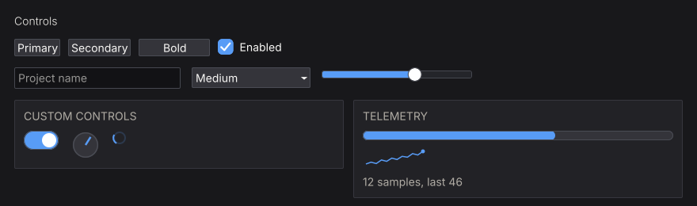

# Widget Gallery

Every widget is an ordinary function exported from `NanoUI`.

<figure class="nano-figure">

<figcaption>Buttons, inputs, and canvas controls in one frame. Rendered with nano-ui-svg.</figcaption>
</figure>

## Find a widget by task

| You need… | Read |
| --- | --- |
| Buttons, menus, checkboxes, toggles, radios, selects, combo boxes, sliders, numeric fields, text fields, color pickers | [Buttons, Menus & Inputs](controls.md) |
| Multi-line text, documents, undo history, IME-aware editing | [Text Editing](text-editing.md) |
| Tabs, sortable tables, trees | [Tabs, Tables & Trees](data-views.md) |
| Modals, floating windows, popups, tooltips, context menus | [Overlays & Windows](overlays.md) |
| Drag-and-drop, tab reordering, dockable pane grids | [Drag & Drop](drag-and-drop.md) |
| Knobs, switches, progress bars, spinners, sparklines, canvas drawing | [Custom Drawing & Controls](custom-drawing.md) |
| Colors, themes, interaction states, fonts | [Styling & Theming](../styling/index.md) |
| Live examples of every styling modifier | [Interactive Styling Lab](../styling/lab.md) |
| Non-obvious styling behavior | [Styling Gotchas](../styling/gotchas.md) |

Containers (`row`, `column`, `grid`, `panel`, `card`, `layers`, ...) and sizing are covered once in [Layout & Scrolling](../layout/index.md).

## How widget names work

The same four forms appear across the library:

| Form | Meaning |
| --- | --- |
| `button "Save"` | Base form. Returns `Bool` (activated) or `()` |
| `button'` | Primed form. Returns a `Response` |
| `buttonWith (fixedW 120)` | Takes a `Layout -> Layout` modifier first |
| `buttonConfigured cfg` | Takes a config record; every config has a `default...Config` |

A `Response` carries identity and interaction state:

| Field / helper | Meaning |
| --- | --- |
| `respId` | The widget's `WidgetId` (focus, menus, scroll targets) |
| `respRect` | The widget's rectangle from the **previous** frame |
| `respHovered` | Pointer is over the widget |
| `respPressed` | Held down, not yet released |
| `respClicked` | Activated: left click, Enter, or Space |
| `respChanged` | The value was edited |
| `respSubmitted` | Committed, for example Enter in a text field |
| `respHeldWith` / `respClickedWith` | Which `MouseButton` is held / clicked |
| `respRightPressed` / `respRightClicked` | Secondary-button variants |

Anything with a `Response` can be passed to `tooltip`, `contextMenu`, and the focus helpers.
