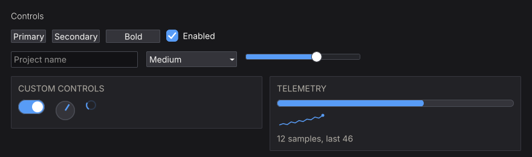

# Widget Gallery

Every widget in `nano-ui` is an ordinary Haskell function exported from `NanoUI`.

<figure class="nano-figure">

<figcaption>Buttons, inputs, and canvas controls in one frame, rendered with nano-ui-svg.</figcaption>
</figure>

## Finding the right widget

| What you need | Chapter |
| --- | --- |
| Buttons, menus, checkboxes, toggles, radio groups, selects, combo boxes, sliders, numeric fields, single-line text inputs, color pickers | [Buttons, Menus & Inputs](controls.md) |
| Multi-line text editing, documents, undo history, IME composition | [Text Editing](text-editing.md) |
| Tabs, sortable tables, tree views | [Tabs, Tables & Trees](data-views.md) |
| Modals, floating windows, popups, tooltips, context menus | [Overlays & Windows](overlays.md) |
| Drag-and-drop, list/tab reordering, dockable pane grids | [Drag & Drop](drag-and-drop.md) |
| Knobs, switches, progress bars, spinners, sparklines, custom 2D canvas drawing | [Custom Drawing & Controls](custom-drawing.md) |
| Colors, themes, interaction states, fonts | [Styling & Theming](../styling/index.md) |
| Interactive previews of styling modifiers | [Interactive Styling Lab](../styling/lab.md) |
| Subtle styling rules and edge cases | [Styling Gotchas](../styling/gotchas.md) |

Layout containers (`row`, `column`, `grid`, `panel`, `card`, `layers`, and so on) and sizing modifiers are covered in [Layout & Scrolling](../layout/index.md).

## Widget naming conventions

Most widgets follow the same four-function naming pattern:

| Form | What it does |
| --- | --- |
| `button "Save"` | Base form. Returns `Bool` (when activated) or `()`. |
| `button'` | Primed form. Returns a full `Response`. |
| `buttonWith (fixedW 120)` | Takes a `Layout -> Layout` modifier as its first argument. |
| `buttonConfigured cfg` | Takes a configuration record (every config has a matching `default...Config`). |

A `Response` holds the widget's identity, layout bounds, and interaction flags for the current frame:

| Field or helper | Meaning |
| --- | --- |
| `respId` | The widget's `WidgetId` (used for focus, menus, and scroll targets). |
| `respRect` | The widget's bounding rectangle from the **previous** frame. |
| `respHovered` | `True` while the pointer is over the widget. |
| `respPressed` | `True` while the mouse button is held down on the widget. |
| `respClicked` | `True` on the frame the widget is activated (left click, Enter, or Space). |
| `respChanged` | `True` on the frame the user edited the widget's value. |
| `respSubmitted` | `True` on the frame the user committed the field (for example, pressing Enter). |
| `respHeldWith` / `respClickedWith` | Check which specific `MouseButton` is held or clicked. |
| `respRightPressed` / `respRightClicked` | Shorthands for right-button interactions. |

Any widget that returns a `Response` can be wired to `tooltip`, `contextMenu`, and the focus helpers.
